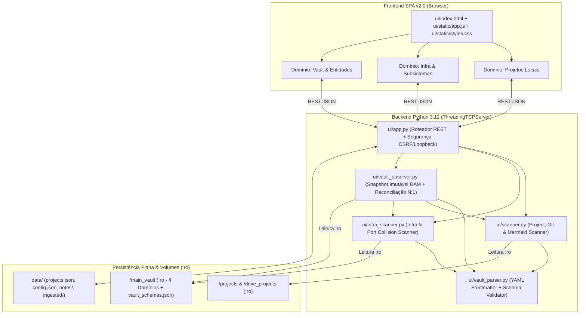

# Arquitetura do Sistema — Nexus Cockpit

O **Nexus Cockpit** adota uma arquitetura modular baseada exclusivamente na biblioteca padrão do Python 3.12 (`stdlib`) no backend e Vanilla JavaScript (ES6+) no frontend, preservando rigorosamente o invariante **`NG4` (*Zero Persistent Database*)**.

---

## 1. Diagrama de Componentes

---

## 2. Módulos do Backend (`ui/`)

### 2.1. `ui/app.py` — Servidor HTTP Concorrente e Hardening Local
- Baseado em `socketserver.ThreadingTCPServer` e `http.server.SimpleHTTPRequestHandler`.
- Serve os ativos estáticos de `ui/` com headers `Cache-Control: no-store, no-cache, must-revalidate, max-age=0` para evitar cache obsoleto no navegador.
- **Endurecimento de Segurança Local**:
  - Container exposto exclusivamente em `127.0.0.1:4100` (loopback).
  - Respostas HTTP e `OPTIONS` não emitem `Access-Control-Allow-Origin: *`.
  - `_validate_mutation_security()` protege todas as rotas mutáveis (`POST`, `PUT`, `DELETE`), bloqueando requisições com `Sec-Fetch-Site: cross-site` ou `Origin` não-loopback (`HTTP 403`) e exigindo `Content-Type: application/json` (`HTTP 415`).

### 2.2. `ui/vault_parser.py` — Parser Zero-Dependency de YAML Frontmatter
- Carrega o manifesto declarativo compartilhado `scripts/harness/vault_schemas.json` (com fallback idêntico embutido em `DEFAULT_VAULT_SCHEMAS`).
- Oferece dois modos de análise:
  - `parse_frontmatter_strict(text)`: Remove UTF-8 BOM (`\ufeff`), exige delimitadores `---` de abertura e fechamento, decodifica escapes (`\\`, `\"`, `\n`, `\t`), processa listas inline `[a, b]` e listas em bloco `- item`, e rejeita estruturas YAML aninhadas ou frontmatter não fechado.
  - `parse_frontmatter_lenient(text)`: Extração tolerante para leitura de documentos de projetos externos.
- `validate_vault_note(...)`: Valida campos obrigatórios (`required_fields`), tipos e `status_enum` por domínio, respeitando isenções declarativas (`exempt_files`) e emitindo avisos não-bloqueantes (`warnings`) para notas auxiliares sem frontmatter em `05_Areas`.

### 2.3. `ui/vault_observer.py` — Snapshot Imutável em Memória e Reconciliação N:1
- Mantém um único dicionário imutável (`_snapshot`) em memória, substituído por referência atômica sob `threading.Lock` (TTL padrão de 60s).
- **Allowlist Estrita de Domínios**:
  - Varre apenas `01_Projetos`, `02_Recursos_e_Infra`, `04_Arquitetura_ADRs` e `05_Areas`.
  - Ignora imediatamente qualquer diretório em `FORBIDDEN_DIR_NAMES` (`chaves_ssh`, `.obsidian`, `.git`, `.agents`, `.vscode`, `.ssh`).
- **Degradação Graciosa de Estados (`vault_status`)**:
  - `available`: Os 4 domínios do `main_vault` foram lidos com sucesso.
  - `degraded`: Ocorreu falha de I/O durante a reindexação (ex.: oscilação do Google Drive Desktop), mas o último snapshot válido em memória foi preservado.
  - `unavailable`: O volume `/main_vault` não está acessível e ainda não há snapshot prévio carregado.
- **Projeção Fechada de Privacidade (`AREAS_SAFE_FIELDS`)**:
  - Notas de `05_Areas` são filtradas no backend através da tupla `AREAS_SAFE_FIELDS` (`rel_path`, `domain`, `entity`, `title`, `area`, `doc_type`, `status`, `frontmatter_status`, `links_status`, `validation_errors`, `size_bytes`, `doc_date`, `indexed_at`). O corpo Markdown e `caminho_drive` jamais são armazenados no snapshot nem serializados na API.
- **Reconciliação N:1 e Matriz Binária de Divergências (`project_repo_links`)**:
  - Suporta múltiplas fichas em `01_Projetos` apontando para um mesmo repositório físico (ex.: módulos do ecossistema `SIAE BR`), contabilizando `sibling_modules_count`.
  - Avalia 3 flags binárias objetivas:
    1. `status_mismatch`: Nota `Ativo` no vault vinculada a projeto `Pausado`/`Concluído`/`Arquivado` no Cockpit (ou vice-versa).
    2. `missing_workspace`: Repositório local referenciado na nota não encontrado nos diretórios montados.
    3. `stale_sync`: Diferença superior a 7 dias entre `ultima_atualizacao` da nota e o último commit Git (ou > 30 dias sem atualização para projetos ativos sem Git).

### 2.4. `ui/scanner.py` — Scanner de Projetos Locais, Git e Mermaid
- Resolve caminhos de projetos locais entre `C:\Docker` (`/projects:ro`), `G:\Meu Drive\01 Projetos` (`/drive_projects:ro`) e diretórios ingeridos (`data/ingested/`), bloqueando diretórios sensíveis do sistema operacional (`DANGEROUS_SYSTEM_PATHS`).
- Extrai blocos `mermaid` de arquivos `.md`, classificando-os automaticamente entre diagramas de banco de dados (`erDiagram`) e fluxos operacionais (`flowchart`, `sequenceDiagram`, `stateDiagram`, `classDiagram`).
- Coleta telemetria Git local (`branch`, `is_dirty`, `uncommitted_count`, `recent_commits`, `last_commit_date`) com timeout de 3 segundos.

### 2.5. `ui/infra_scanner.py` — Catálogo Passivo de Infraestrutura e Portas
- Indexa as fichas de servidores em `02_Recursos_e_Infra` com cache TTL de 30s, ignorando documentos de especificação geral listados em `exempt_files` (`HOME_LAB_SPECIFICATIONS.md`, `Oracle.md`).
- Cruza as portas declaradas nos servidores (`servicos_ativos`) com as portas mapeadas nos arquivos `docker-compose.yml` dos projetos locais para alimentar o Radar de Colisão de Portas.
