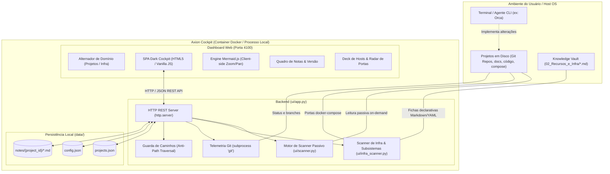
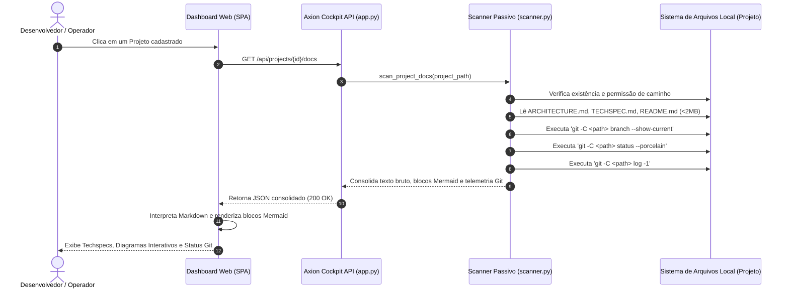
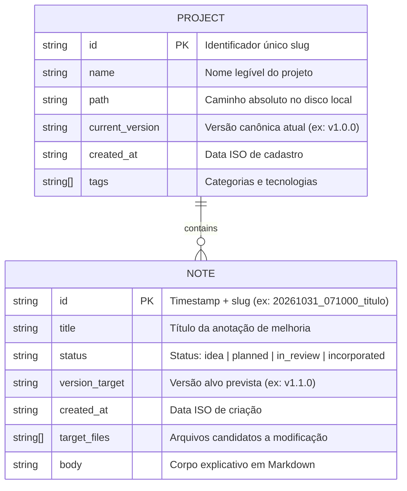

# Arquitetura — Axion Cockpit

O **Axion Cockpit** é um console local de observabilidade e gestão operacional para desenvolvedores e arquitetos que gerenciam múltiplos projetos distribuídos no sistema de arquivos.

Este documento formaliza a arquitetura do sistema, seus fluxos de trabalho e seus modelos de persistência desacoplada.

---

## 1. Princípios Arquiteturais

1. **Princípio do Observador Passivo**:
   - O Axion Cockpit não altera o código dos projetos monitorados nem força padrões invasivos.
   - Não requer agentes nem orquestração ativa rodando dentro dos projetos da frota.
2. **Zero Drift (Leitura On-Demand)**:
   - Toda inspeção de documentação é lida sob demanda diretamente do disco em tempo real (<1ms em SSDs locais).
   - Não são mantidos caches redundantes de especificações técnicas ou diagramas.
3. **Zero Dependências Externas (Python Stdlib)**:
   - O backend opera 100% sobre a biblioteca padrão do Python (`http.server`, `socketserver`, `pathlib`, `re`, `subprocess`).
   - Não necessita de gerenciadores de pacotes (`pip`), frameworks pesados (`FastAPI`, `Django`) ou compiladores de runtime no host.
4. **Renderização Client-Side**:
   - O processamento visual de diagramas (`flowchart`, `sequenceDiagram`, `erDiagram`) é executado no navegador do usuário via **Mermaid.js**, com controles dinâmicos de zoom, pan e tela cheia.
5. **Ledger de Ideias e Débitos Desacoplado**:
   - Anotações de melhoria e débitos técnicos são salvos em arquivos Markdown com frontmatter YAML leve no diretório do console (`data/notes/{project_id}/`), mantendo o repositório monitorado limpo até a formalização de novas versões.

---

## 2. Visão Geral dos Componentes

---

## 3. Fluxo de Inspeção e Telemetria

---

## 4. Modelo de Entidades e Persistência

A persistência do Axion Cockpit é intencionalmente baseada em arquivos planos (`JSON` e `Markdown`), eliminando a necessidade de bancos relacionais ou motores de migração:

---

## 5. Especificação Técnica (Techspec)

| Propriedade | Especificação |
|---|---|
| **Runtime Backend** | Python 3.10+ (Standard Library) |
| **Dependências pip** | Zero (`pip install` desnecessário) |
| **Porta Padrão** | `4100` (TCP) |
| **Host Bind** | `127.0.0.1` (local) ou `0.0.0.0` (Docker) |
| **Frontend** | Vanilla JavaScript (ES6+), CSS Grid/Flexbox moderno, Mermaid.js v10 via CDN |
| **Arquivos de Dados** | `data/projects.json` e `data/notes/{project_id}/*.md` |
| **Formatos Reconhecidos** | `ARCHITECTURE.md`, `TECHSPEC.md`, `WORKFLOWS.md`, `DATABASE.md`, `README.md` |
