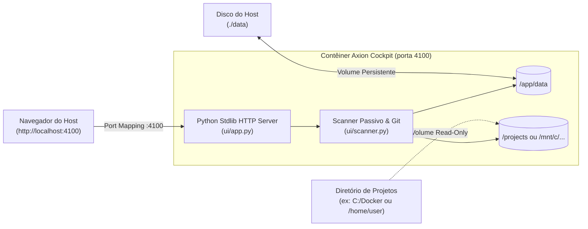

# Guia de Operação com Docker — Axion Cockpit

O **Axion Cockpit** foi projetado para execução imediata em contêineres Docker, mantendo seu princípio fundamental de **Zero Dependências de Terceiros** (executa com a biblioteca padrão do Python 3.12 em uma imagem `slim` enxuta).

---

## 1. Visão Geral da Arquitetura de Contêiner



---

## 2. Inicialização Rápida com Docker Compose (Recomendado)

O método mais simples e completo é utilizar o [docker-compose.yml](file:///C:/Docker/axion-cockpit/docker-compose.yml):

```bash
# 1. Construir a imagem e iniciar em background
docker compose up -d --build

# 2. Inspecionar logs em tempo real
docker compose logs -f

# 3. Verificar status e healthcheck
docker compose ps

# 4. Parar o serviço
docker compose down
```

A interface estará disponível em: **`http://localhost:4100`**

---

## 3. Uso Direto via Docker CLI

### 3.1. Build da Imagem
```bash
docker build -t axion-cockpit:latest .
```

### 3.2. Executar Contêiner
```bash
# Execução simples com persistência do catálogo de dados
docker run -d \
  --name axion-cockpit \
  -p 4100:4100 \
  -v $(pwd)/data:/app/data \
  --restart unless-stopped \
  axion-cockpit:latest
```

---

## 4. Mapeamento de Volumes e Inspeção de Projetos Locais

O Axion Cockpit opera como um **observador passivo** que lê repositórios e arquivos Markdown em disco. Para que o contêiner consiga ler os projetos da sua máquina hospedeira, mapeie os diretórios desejados:

### Cenário A: Mapeando pasta de projetos no Docker Compose
No arquivo `docker-compose.yml`, defina a variável `PROJECTS_HOST_DIR` ou ajuste o mapeamento:

```yaml
volumes:
  - ./data:/app/data
  # Monta seu diretório de repositórios em modo somente-leitura (ro)
  - C:/Docker:/projects:ro
```

Ao cadastrar um projeto na interface web, informe o caminho correspondente dentro do contêiner (ex: `/projects/meu-projeto`).

### Cenário B: Compatibilidade de Caminhos Windows / WSL
O scanner nativo ([ui/scanner.py](file:///C:/Docker/axion-cockpit/ui/scanner.py)) possui conversão transparente para caminhos montados em `/mnt/{drive}`:
- Caminho no host Windows: `C:\Docker\meu-projeto`
- Mapeamento no Docker: `-v C:\Docker:/mnt/c/Docker:ro`
- O Axion Cockpit resolverá tanto `/mnt/c/Docker/meu-projeto` quanto referências equivalentes sem necessidade de alteração de código.

---

## 5. Variáveis de Ambiente

| Variável | Valor Padrão | Descrição |
|---|---|---|
| `HOST` | `0.0.0.0` (Docker) / `127.0.0.1` (Local) | Interface de rede para bind do socket TCP. |
| `PORT` | `4100` | Porta TCP onde o servidor responderá requisições. |
| `PYTHONUNBUFFERED` | `1` | Garante emissão de logs imediata sem buffer no stdout do contêiner. |
| `PYTHONDONTWRITEBYTECODE` | `1` | Evita criação de arquivos `.pyc` nos volumes montados. |

---

## 6. Healthcheck Integrado

A imagem possui verificação de integridade nativa via biblioteca padrão do Python, sem depender de ferramentas extras:

```dockerfile
HEALTHCHECK --interval=30s --timeout=5s --start-period=5s --retries=3 \
    CMD python -c "import urllib.request; urllib.request.urlopen('http://127.0.0.1:4100/api/projects').read()" || exit 1
```

Para verificar o status de saúde do contêiner em execução:
```bash
docker inspect --format='{{json .State.Health}}' axion-cockpit
```

---

## 7. Execução dos Testes Automatizados no Docker

Você pode executar toda a suíte de testes unitários isolada dentro do ambiente Docker sem precisar instalar nada no host:

```bash
docker compose run --rm axion-cockpit python -m unittest discover -s tests -p "test_*.py"
```
