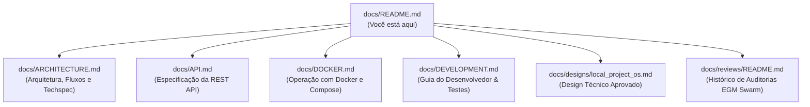

# Documentação do Axion Cockpit

Bem-vindo ao centro de documentação do **Axion Cockpit**, o console local de observabilidade arquitetural e gestão operacional da frota de projetos.

---

## Mapa da Documentação

---

## Seções Principais

### 1. [Arquitetura & Especificação](file:///C:/Docker/axion-cockpit/docs/ARCHITECTURE.md)
* Princípios de design (Observador Passivo, Zero-Drift, Zero-Dependencies).
* Diagramas de componentes e fluxogramas operacionais em Mermaid.js.
* Modelo de persistência em arquivos planos (`projects.json` e Markdown).
* Especificação técnica do sistema.

### 2. [Referência da REST API](file:///C:/Docker/axion-cockpit/docs/API.md)
* Documentação de todos os endpoints REST (`/api/projects`, `/api/projects/{id}/docs`, `/api/projects/{id}/notes`, `/api/projects/{id}/version`).
* Exemplos de requisições, payloads JSON e códigos de resposta HTTP.

### 3. [Guia de Docker & Contêineres](file:///C:/Docker/axion-cockpit/docs/DOCKER.md)
* Inicialização rápida via `docker compose up -d`.
* Mapeamento de volumes para inspeção de repositórios locais do host.
* Configuração de variáveis de ambiente (`HOST`, `PORT`).
* Verificação de integridade e Healthcheck.

### 4. [Guia de Desenvolvimento & Testes](file:///C:/Docker/axion-cockpit/docs/DEVELOPMENT.md)
* Configuração de ambiente local (Python Stdlib e `uv`).
* Como executar e estender a suíte de testes automatizados (`tests/test_server.py`).
* Boas práticas de contribuição e convenções de código.

### 5. [Design Técnico Formal](file:///C:/Docker/axion-cockpit/docs/designs/local_project_os.md)
* Documento formal aprovado após a revisão arquitetural, detalhando os objetivos, não-objetivos e a desvinculação da antiga biblioteca de skills.

### 6. [Histórico de Auditorias e Revisões (EGM Swarm)](file:///C:/Docker/axion-cockpit/docs/reviews/README.md)
* Registro completo das deliberações das lentes de arquitetura (`egm-zoom-out`, `egm-comprehension`, `egm-design`, `egm-implementation-readiness`, `egm-synthesizer`).
