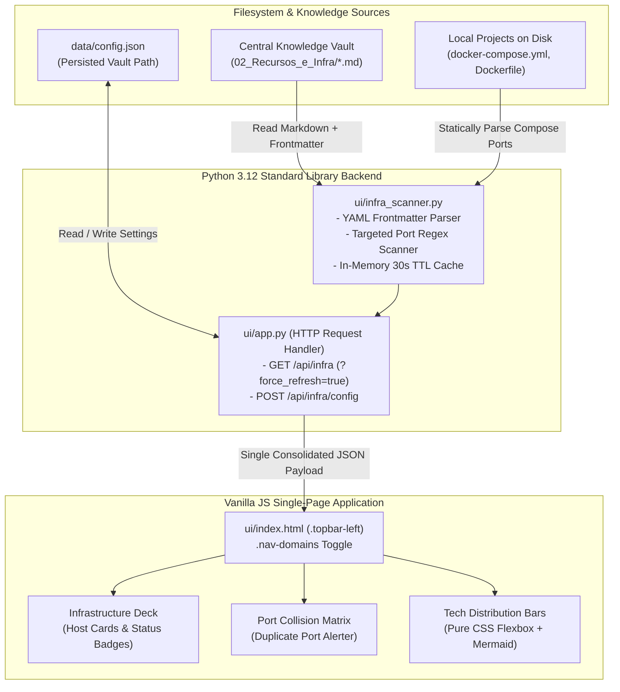

# Technical Design Document: Passive Infrastructure Catalog & Subsystem Visualization (Nexus Cockpit)

* **Status:** Remediated & Approved (Post-EGM Swarm Review) — Evolved in [vault_observability_and_entity_cockpit.md](vault_observability_and_entity_cockpit.md)
* **Author:** Sandro Freitas & Antigravity
* **Date:** 2026-11-07
* **Audit Report:** [docs/reviews/consolidated_review_report.md](../reviews/consolidated_review_report.md)

---

## 1. The Problem

Axion Cockpit operates as a local architectural observer for software repositories, inspecting Git telemetry, Markdown documentation, and Mermaid diagrams from directories on disk. However, developers and systems architects face three operational visibility gaps when managing multi-project ecosystems:

1. **Disconnected Infrastructure Awareness**: Physical bare-metal servers, cloud VPS (Virtual Private Server) instances, databases, and network gateways are documented separately in knowledge vaults (such as `02_Recursos_e_Infra` in the central Obsidian vault). Today, there is no consolidated bridge between local code projects and the hosts that run them.
2. **Hidden Local Subsystem & Port Conflicts**: Modern projects declare backend services, databases, cache layers, and network ports inside `docker-compose.yml` or `Dockerfile`. Without a unified local catalog, developers inadvertently bind identical host ports (e.g., two projects exposing `5432:5432` or `8080:80`), causing runtime collisions and debugging friction.
3. **The Active APM Trap**: Traditional APM (Application Performance Monitoring) and monitoring tools (Prometheus, Grafana, Portainer, Uptime Kuma) introduce heavyweight background daemons, persistent polling loops, external database engines, and credential managers. For local architecture and project navigation, this overhead violates the core product invariant of Axion Cockpit: zero external pip dependencies, instant startup via Python standard library, and zero passive drift.

---

## 2. Overview

This design extends Axion Cockpit to serve as a **Passive Infrastructure and Subsystem Catalog**. It indexes two complementary dimensions of operational documentation without running background threads or active network probes:

- **Macro-Level Global Infrastructure**: Ingests declarative host specification Markdown files containing YAML frontmatter located in the central vault (`02_Recursos_e_Infra`). It extracts resource identity, host address, operating system, declared operational status, active services, and classification tags.
- **Micro-Level Project Subsystems**: Scans local project directories to statically parse declared services, container images, and port bindings from `docker-compose.yml` and `Dockerfile`.
- **Integrated Cockpit UI**: Introduces a dedicated "Global Infrastructure" view accessible via a topbar domain switcher, featuring modular status cards, native CSS flexbox distribution bars, Mermaid.js technology breakdown diagrams, and a proactive port collision matrix.

The system strictly adheres to the **Passive Observer Principle**:
- **Zero Network Pinging / Zero ICMP Probing**: Displays declared documentation status, explicitly avoiding deceptive "live uptime" indicators that mask documentation drift. (ICMP = Internet Control Message Protocol).
- **Zero Third-Party Pip Dependencies**: Uses a custom, lightweight Python stdlib YAML frontmatter parser and targeted regex manifest extractors without importing `PyYAML` or external packages.
- **Zero Persistent Database**: Aggregates records on-demand directly from disk with in-memory TTL caching (30s) and manual force-refresh support to avoid filesystem I/O bottlenecks over virtual cloud drives (Google Drive / `G:\`).

---

## 3. Goals and Non-Goals

### 3.1. Goals
* **G1 - Declarative Vault Ingestion**: Parse Markdown frontmatter from `02_Recursos_e_Infra` using standard Python library routines, returning structured host and asset records.
* **G2 - Static Subsystem Port Scanning**: Automatically extract service definitions, container images, and host:container port mappings from registered local projects (`docker-compose.yml` and `Dockerfile`).
* **G3 - Port Collision Matrix**: Detect and highlight duplicate host port exposures across local projects and declared infrastructure services to prevent local port binding failures.
* **G4 - Topbar Domain Separation**: Provide a clear UI toggle in the topbar between `Projects View` (Git, architecture, Markdown notes) and `Global Infrastructure View` (hosts, services, port matrix, technology distribution).
* **G5 - Zero-CDN Visualizations**: Render technology distributions using native CSS flexbox bars, SVG badges, and client-side Mermaid.js blocks without importing external charting libraries.
* **G6 - Cross-Platform Vault Path Resolution**: Support seamless vault resolution across Windows host (`G:\Meu Drive\...`), Docker container mounts (`/vault`), environment variables (`AXION_VAULT_PATH`), WSL mounts (`/mnt/...`), and UI-driven runtime persistence (`data/config.json`).
* **G7 - Resilient In-Memory Caching**: Implement a 30-second in-memory TTL cache with on-demand refresh (`?force_refresh=true`) to protect against virtual cloud drive latency and Google Drive `st_mtime` sync anomalies.

### 3.2. Non-Goals
* **NG1 - Active Network Telemetry / Probing**: The system will not send ICMP pings, open TCP sockets, or send HTTP requests to verify whether hosts or containers are reachable.
* **NG2 - Bi-directional Vault Modifications**: The UI will not write back or edit host Markdown files in the vault. All edits occur in the operator's Markdown editor.
* **NG3 - Background Daemon Threads / Schedulers**: No cron jobs, background polling loops, or async worker threads will run in the Python process.
* **NG4 - Third-Party Pip Packages**: No installation of `PyYAML`, `requests`, `fastapi`, or external dependencies.
* **NG5 - Container Orchestration / Control**: The system will not start, stop, or restart Docker containers. Container execution remains strictly in the developer's terminal or external tooling.
* **NG6 - Full Docker Compose AST / Arbitrary YAML Parsing**: The scanner does not parse full Compose syntax trees, extensions, or complex YAML anchors; it strictly targets standard port mapping syntax lines.
* **NG7 - Speculative Package Dependency Scraping**: Scraping package manifests (`package.json`, `pyproject.toml`) for framework or library detection is out of scope.

---

## 4. Technical Plan

### 4.1. High-Level Architecture & Component Boundaries

The feature introduces a clean architectural seam by isolating infrastructure and manifest operations in a new dedicated module, `ui/infra_scanner.py`, keeping `ui/scanner.py` focused on project directory navigation and Git telemetry.



---

### 4.2. Data Models & Schemas

All schemas use native Python dictionaries and primitive types to maintain zero-dependency serialization via `json.dumps()`.

> [!NOTE]
> The Portuguese keys in `InfraResource` (`recurso`, `tipo`, `entidade`, `servicos_ativos`) directly match the existing Obsidian frontmatter convention of the operator's vault files in `02_Recursos_e_Infra`.

#### 4.2.1. `InfraResource`
Represents an individual physical, virtual, or cloud host record extracted from the vault.

```json
{
  "id": "homelab-notebook",
  "recurso": "Home Lab Notebook",
  "tipo": "Bare-Metal Server (24/7)",
  "entidade": "Pessoal",
  "host": "192.168.15.176",
  "os": "Ubuntu Server",
  "hardware": "Notebook Dell (Tampa Fechada)",
  "status": "Ativo / Produção",
  "servicos_ativos": [
    "Cockpit (:9090)",
    "Portainer (:9000 / :9443)",
    "Samba NAS (Z:)",
    "Immich (:2283)",
    "Tailscale VPN",
    "Sistema de Obras (:3080 / :8080 / :5435)"
  ],
  "ports": [9090, 9000, 9443, 2283, 3080, 8080, 5435],
  "tags": ["recurso", "homelab", "pessoal"],
  "filepath": "G:\\Meu Drive\\main_vault\\02_Recursos_e_Infra\\HomeLab_Notebook.md",
  "updated_at": "2026-11-06T19:04:00+00:00"
}
```

#### 4.2.2. `SubsystemPortBinding`
Represents an exposed port entry detected in a local project or vault infrastructure host.

```json
{
  "host_port": 8080,
  "container_port": 80,
  "protocol": "tcp",
  "source_type": "project_compose",
  "source_id": "axion-cockpit",
  "source_label": "Axion Cockpit (web)",
  "is_collision": true,
  "collision_count": 2,
  "conflicting_sources": [
    "Homelab Notebook: Sistema de Obras (:8080)"
  ]
}
```

#### 4.2.3. Unified Response Payload (`GET /api/infra`)
Consolidates all infrastructure information into a single atomic payload to prevent sequential HTTP blocking on Python's single-threaded server.

```json
{
  "vault_status": "ok",
  "vault_path": "G:\\Meu Drive\\main_vault\\02_Recursos_e_Infra",
  "resources": [ /* Array of InfraResource */ ],
  "ports": {
    "bindings": [ /* Array of SubsystemPortBinding */ ],
    "collision_count": 1,
    "collisions": [ /* Filtered array of colliding bindings */ ]
  },
  "metrics": {
    "total_hosts": 6,
    "by_type": { "Bare-Metal": 2, "VPS": 3, "Cloud": 1 },
    "by_os": { "Ubuntu": 4, "Windows": 1, "Alpine": 1 },
    "by_entity": { "Pessoal": 2, "ICENV": 2, "SIAE BR": 2 }
  }
}
```

---

### 4.3. Deterministic Parsing Specifications

#### 4.3.1. Frontmatter Parsing (`parse_yaml_frontmatter`)
To uphold the zero-pip invariant without importing `PyYAML`, `ui/infra_scanner.py` implements a resilient line parser:
1. **Delimiter Detection**: Scans lines between initial `---` and closing `---`. If no closing delimiter is found, returns empty dictionary with error status.
2. **Scalar Extraction**: Splits line on the first colon only: `key, val = line.split(":", 1)`. Strips whitespace and surrounding matching quotes (`'`, `"`).
3. **List Parsing**: Detects indented hyphen bullet lists (`^\s*-\s+(.*)`) and inline JSON-style arrays (`[item1, item2]`).
4. **Resilient Defaults**: Unset or empty attributes default safely (`status: "Desconhecido"`, `servicos_ativos: []`, `tags: []`).

#### 4.3.2. Vault Port Extraction Contract
For every string entry in `servicos_ativos`:
- Apply deterministic regex: `re.findall(r':(\d{2,5})\b', service_str)`.
- Convert matched digits to integers.
- Example: `"Sistema de Obras (:3080 / :8080 / :5435)"` yields `[3080, 8080, 5435]`.
- Example: `"Tailscale VPN"` yields `[]` (service is registered without port binding).

#### 4.3.3. Compose Port Regex Extraction
To extract ports without building a full Compose AST parser:
- Scan `docker-compose.yml` line by line.
- Match standard short-syntax port lines:
  ```python
  COMPOSE_PORT_REGEX = re.compile(
      r'^\s*-\s*["\']?(?:(?:[\d.]+):)?(\d{2,5})(?::(\d{2,5}))?(?:/(tcp|udp))?["\']?\s*$'
  )
  ```
- If two ports are specified (`8080:80`), group 1 is `host_port` (8080) and group 2 is `container_port` (80).
- If one port is specified (`8000`), `host_port` is 8000 and `container_port` is 8000.
- Normalizes IP-bound formats (`127.0.0.1:8080:80` -> host port 8080).

---

### 4.4. Cross-Platform Vault Resolution Cascade

The vault location is resolved at runtime through a strict priority cascade:
1. **Environment Variable**: `os.environ.get("AXION_VAULT_PATH")`
2. **Persisted Configuration**: Key `vault_path` in `data/config.json`
3. **Default Windows Google Drive**: `G:\Meu Drive\main_vault\02_Recursos_e_Infra`
4. **Docker Container Mount**: `/vault`
5. **WSL Mount**: `/mnt/g/Meu Drive/main_vault/02_Recursos_e_Infra`

Every candidate string is passed through `scanner.resolve_cross_platform_path()` to handle Windows, Docker volume, and WSL translation automatically. If no valid directory exists, the scanner returns `vault_status: "not_configured"`.

---

### 4.5. In-Memory 30-Second TTL Caching

To prevent virtual cloud drive (Google Drive) I/O latency and avoid the filesystem bug where in-place file edits do not update parent folder `st_mtime`:
1. Cache state stores `(cached_data, timestamp)`.
2. When a request arrives at `GET /api/infra`:
   - If `query_params.get("force_refresh") == "true"`: cache is invalidated immediately and files are re-scanned.
   - If `time.time() - timestamp < 30.0`: return `cached_data` immediately.
   - If elapsed time exceeds 30 seconds: re-scan vault directory and project manifests, updating `cached_data` and `timestamp`.

---

### 4.6. REST API Endpoints

| Method | Endpoint | Description | Query / Body Params |
| :--- | :--- | :--- | :--- |
| `GET` | `/api/infra` | Returns unified catalog of infrastructure hosts, port collision matrix, and metrics | `?force_refresh=true` (optional) |
| `POST` | `/api/infra/config` | Updates configured vault path and verifies directory existence | `{"vault_path": "string"}` |

#### Error Responses on `POST /api/infra/config`:
* Missing body or invalid JSON: HTTP 400 `{"status": "error", "message": "Corpo da requisição deve ser um JSON válido."}`
* Missing `vault_path` key: HTTP 400 `{"status": "error", "message": "Chave 'vault_path' é obrigatória."}`
* Directory not found or not a directory: HTTP 400 `{"status": "error", "message": "O caminho informado não existe ou não é um diretório válido."}`

---

### 4.7. Frontend User Experience & DOM Contract

#### 4.7.1. Topbar Domain Switcher Markup
Inserted in `ui/index.html` inside `<div class="topbar-left">`, placed immediately after `<div class="topbar-divider"></div>` and before `<div class="topbar-breadcrumb">`:

```html
<div class="nav-domains">
  <button class="domain-btn active" data-domain="projects">📦 Projetos Locais</button>
  <button class="domain-btn" data-domain="infra">🌐 Infraestrutura Global</button>
</div>
```

#### 4.7.2. DOM Container Placement
Inserted in `ui/index.html` inside `<main class="main-wrapper">`, placed alongside `#view-empty` and `#view-project`:

```html
<section id="infra-view" class="infra-view hidden">
  <div class="infra-header">
    <div class="infra-title-block">
      <h2>Catálogo de Infraestrutura & Subsistemas</h2>
      <span class="badge-passive">Estado Declarado (Passivo)</span>
    </div>
    <button id="btn-infra-refresh" class="btn-refresh" title="Recarregar dados do disco">🔄 Atualizar</button>
  </div>
  
  <div id="infra-metrics-row" class="infra-metrics-row"></div>
  <div id="infra-radar-banner" class="infra-radar-banner hidden"></div>
  <div id="infra-charts-panel" class="infra-charts-panel"></div>
  <div id="infra-deck-grid" class="infra-deck-grid"></div>
</section>
```

#### 4.7.3. Visibility Toggling Rule
In `ui/static/styles.css`:
```css
.hidden {
  display: none !important;
}
```

---

## 5. Alternatives Considered

### 5.1. Adding Third-Party Packages (`PyYAML`, `fastapi`, `pydantic`)
* **Description**: Install open-source libraries via `pip` or virtualenv to parse YAML, handle schema validation, and serve REST endpoints.
* **Reason for Rejection**: Directly violates the core product invariant of Axion Cockpit: zero external dependencies, instant zero-setup execution (`python ui/app.py`), and operational portability across minimal Alpine/Debian Docker containers without `pip install` overhead. Targeted regex scanning extracts the necessary data in pure standard library Python.

### 5.2. Active Network Probing & ICMP Ping Loops
* **Description**: Perform active TCP connection attempts (`socket.create_connection`) or send ICMP pings to remote hosts and container ports to display real-time availability lights.
* **Reason for Rejection**: The Python backend runs on a single-threaded standard library `http.server`. When remote servers (e.g., Oracle Cloud VPS or residential homelabs) are unreachable or experiencing high network latency, socket timeouts freeze the entire web server, degrading page load times. Furthermore, active probing drifts toward duplicating dedicated APM solutions (e.g., Uptime Kuma) rather than providing a clean architectural catalog.

### 5.3. Interfacing Directly with the Docker Daemon Socket (`/var/run/docker.sock`)
* **Description**: Mount the host Docker socket into Axion Cockpit and query `docker.sock` to inspect live container states and real-time port mappings.
* **Reason for Rejection**: Requires elevated container privileges, introduces security risks on shared developer workstations, and fails on remote machines or systems using Docker rootless / Podman. Static manifest parsing of `docker-compose.yml` delivers architectural port collision visibility without runtime socket access.

### 5.4. Mixing Infrastructure Hosts into the Projects Sidebar
* **Description**: Treat infrastructure records as projects in `data/projects.json`, listing them in the existing left navigation bar alongside software repositories.
* **Reason for Rejection**: Conflates fundamentally different domain concepts. Software projects track Git branches, dirty working trees, commit histories, and code architecture documents. Infrastructure hosts track physical/virtual specs, IP allocations, operating systems, and hosted services. Forcing them into the same sidebar creates cognitive clutter and degrades navigation ergonomics.

### 5.5. Client-Side Charting Libraries via CDN (Chart.js / ApexCharts)
* **Description**: Load popular JavaScript visualization libraries from public CDNs to render donuts and bar charts.
* **Reason for Rejection**: Violates the offline-first requirement for air-gapped environments or local development during network outages. Native CSS flexbox proportional bars and embedded Mermaid.js diagrams provide visual breakdowns with zero external asset downloads.

---

## 6. Detailed Implementation Plan

### 6.1. File Inventory and Rationale

| File Path | Action | Rationale |
| :--- | :--- | :--- |
| `ui/infra_scanner.py` | Create | Implements YAML frontmatter parser, vault file discovery, targeted Compose port regex extractor, port collision detector, and the 30-second in-memory TTL cache. |
| `ui/app.py` | Modify | Registers routing for `GET /api/infra` and `POST /api/infra/config`. Implements `CONFIG_FILE = DATA_DIR / "config.json"`, `load_config()`, and `save_config()`. |
| `ui/index.html` | Modify | Adds domain switcher in `.topbar-left` and `#infra-view` section container inside `<main class="main-wrapper">`. |
| `ui/static/app.js` | Modify | Implements domain state management, unified `/api/infra` fetch with `?force_refresh=true`, card template rendering, clipboard interaction, and port collision alerts. |
| `ui/static/styles.css` | Modify | Implements `.nav-domains`, `.infra-view`, `.infra-deck-grid`, `.hidden`, and port warning badge styling matching the existing dark cockpit palette. |
| `docker-compose.yml` | Modify | Adds optional read-only volume mount for the vault (`- "${AXION_VAULT_HOST_DIR:-G:/Meu Drive/main_vault/02_Recursos_e_Infra}:/vault:ro"`). |
| `tests/test_infra_scanner.py` | Create | Automated unit test suite verifying YAML frontmatter parsing, Compose port regex extraction, port collision detection, and TTL cache expiry. |
| `docs/API.md` | Modify | Adds formal REST documentation for `GET /api/infra` and `POST /api/infra/config`. |
| `docs/ARCHITECTURE.md` | Modify | Updates Mermaid diagrams to document `infra_scanner.py` and the dual-domain console architecture. |

---

### 6.2. Step-by-Step Execution Sequence

#### Step 1: Implementation of `ui/infra_scanner.py`
1. **Frontmatter Parser (`parse_yaml_frontmatter(content: str) -> Dict[str, Any]`)**:
   - Locates initial `---` and closing `---`. If unclosed, returns `{}`.
   - Iterates lines:
     - Strips trailing inline comments (`#...`).
     - If line matches `^[a-zA-Z0-9_-]+:`, splits on the first colon (`line.split(":", 1)`).
     - Strips whitespace and surrounding matching quotes (`'`, `"`).
     - If line starts with `- ` under a list key, appends trimmed string to the list.
     - If line is inline array `[a, b]`, parses comma-separated entries.
   - Enforces safe defaults: `recurso`: file stem, `tipo`: `"Não informado"`, `status`: `"Desconhecido"`, `servicos_ativos`: `[]`, `tags`: `[]`.
2. **Vault Port Extraction (`extract_ports_from_services(services: List[str]) -> List[int]`)**:
   - Runs `re.findall(r':(\d{2,5})\b', service)` on each string in `servicos_ativos`.
   - Returns sorted unique list of integer ports.
3. **Compose Port Extractor (`scan_project_ports(project_path: Path) -> List[Dict[str, Any]]`)**:
   - Resolves path via `scanner.resolve_cross_platform_path(str(project_path))`.
   - Checks for `docker-compose.yml` or `docker-compose.yaml`.
   - Scans lines matching `COMPOSE_PORT_REGEX = re.compile(r'^\s*-\s*["\']?(?:(?:[\d.]+):)?(\d{2,5})(?::(\d{2,5}))?(?:/(tcp|udp))?["\']?\s*$')`.
   - Maps group 1 as `host_port` and group 2 (or group 1 if single) as `container_port`.
4. **Collision Radar (`detect_port_collisions(vault_resources, project_ports) -> Dict[str, Any]`)**:
   - Collects all bindings:
     - From vault resources: for each port in `resource["ports"]`, maps host port to `resource["recurso"]`.
     - From project ports: maps host port to project name and service.
   - Groups bindings by `host_port`. Any port with more than one unique source is marked with `is_collision: True`.
5. **Cached Vault Scanner (`get_infrastructure_catalog(force_refresh: bool = False) -> Dict[str, Any]`)**:
   - Checks global in-memory state: `_CACHE = {"data": None, "timestamp": 0.0}`.
   - If not `force_refresh` and `time.time() - _CACHE["timestamp"] < 30.0` and `_CACHE["data"]` is not None:
     - Return `_CACHE["data"]`.
   - Resolves vault directory using priority cascade (`AXION_VAULT_PATH` -> `config.json` -> `G:\...` -> `/vault`).
   - If directory does not exist, returns `{"vault_status": "not_configured", "resources": [], "ports": {"bindings": [], "collisions": []}, "metrics": {}}`.
   - Iterates `.md` files in directory (ignoring `README.md`, `chaves_ssh/`, and hidden files).
   - Reads each file with `encoding="utf-8", errors="replace"` and extracts frontmatter + ports.
   - Iterates projects in `data/projects.json`, extracting project compose ports.
   - Computes port collision matrix and summary metrics (`by_type`, `by_os`, `by_entity`).
   - Saves to `_CACHE` and returns payload.

#### Step 2: REST Routing & Helpers in `ui/app.py`
1. Declare configuration constants:
   ```python
   CONFIG_FILE = DATA_DIR / "config.json"

   def load_config() -> Dict[str, Any]:
       if CONFIG_FILE.exists():
           try:
               with open(CONFIG_FILE, "r", encoding="utf-8") as f:
                   return json.load(f)
           except Exception:
               pass
       return {}

   def save_config(cfg: Dict[str, Any]) -> None:
       DATA_DIR.mkdir(parents=True, exist_ok=True)
       with open(CONFIG_FILE, "w", encoding="utf-8") as f:
           json.dump(cfg, f, indent=2, ensure_ascii=False)
   ```
2. In `do_GET`:
   - Match `path == "/api/infra"`:
     - Parse query parameters: `query = urllib.parse.parse_qs(urllib.parse.urlparse(self.path).query)`.
     - `force_refresh = query.get("force_refresh", ["false"])[0].lower() == "true"`.
     - Call `infra_scanner.get_infrastructure_catalog(force_refresh=force_refresh)`.
     - Respond with HTTP 200 JSON payload.
3. In `do_POST`:
   - Match `path == "/api/infra/config"`:
     - Parse request body JSON.
     - Validate presence of `"vault_path"`. If missing, `self.send_error_json("Chave 'vault_path' é obrigatória.", 400)`.
     - Resolve path via `scanner.resolve_cross_platform_path(raw_path)`.
     - If not path.exists() or not path.is_dir(): `self.send_error_json("O caminho informado não existe ou não é um diretório válido.", 400)`.
     - Update config: `cfg = load_config(); cfg["vault_path"] = str(path); save_config(cfg)`.
     - Invalidate `infra_scanner` cache.
     - Respond with HTTP 200 `{"status": "ok", "vault_path": str(path)}`.

#### Step 3: Frontend SPA Expansion (`ui/index.html`, `ui/static/app.js`, `ui/static/styles.css`)
1. **`ui/index.html`**:
   - Insert `.nav-domains` in `.topbar-left` between `.topbar-divider` and `.topbar-breadcrumb`.
   - Insert `<section id="infra-view" class="infra-view hidden">` inside `<main class="main-wrapper">` as a peer to `#view-empty` and `#view-project`.
2. **`ui/static/app.js`**:
   - Track `currentDomain = 'projects'`.
   - Add click listener on `.domain-btn`:
     - Toggle `.active` class on buttons.
     - If `domain === 'infra'`:
       - Hide `.sidebar`, `#view-empty`, and `#view-project`.
       - Show `#infra-view`.
       - Trigger `loadInfraData()`.
     - If `domain === 'projects'`:
       - Show `.sidebar`, hide `#infra-view`.
       - Restore previous active project view or `#view-empty`.
   - `loadInfraData(forceRefresh = false)`:
     - Fetch `/api/infra` (with `?force_refresh=true` if requested).
     - Render metric chips (Total Hosts, Active Services, Port Conflicts).
     - If `ports.collision_count > 0`: display warning banner with list of conflicting ports and sources.
     - Render distribution bars in `#infra-charts-panel` using native CSS flexbox bars.
     - Render host cards in `#infra-deck-grid` with IP copy buttons (`navigator.clipboard.writeText`) and service pills.
3. **`ui/static/styles.css`**:
   - Add `.hidden { display: none !important; }`.
   - Style `.nav-domains` button group (capsule shape, dark surface, blue active state).
   - Style `.infra-deck-grid` using CSS Grid: `grid-template-columns: repeat(auto-fill, minmax(320px, 1fr)); gap: 16px;`.
   - Style `.port-conflict-badge` in amber/red with bold mono text.

#### Step 4: Container Configuration & Tests
1. **`docker-compose.yml`**:
   - Add optional read-only volume mount:
     ```yaml
     volumes:
       - "${AXION_VAULT_HOST_DIR:-G:/Meu Drive/main_vault/02_Recursos_e_Infra}:/vault:ro"
     ```
2. **`tests/test_infra_scanner.py`**:
   - `test_parse_frontmatter_valid()`: Asserts scalar and list values match expected dictionary.
   - `test_parse_frontmatter_unclosed()`: Asserts unclosed `---` returns `{}` without raising an exception.
   - `test_extract_ports_from_services()`: Tests extraction on `["Immich (:2283)", "Sistema (:3080 / :8080)", "Tailscale"]`, asserting `[2283, 3080, 8080]`.
   - `test_compose_port_regex()`: Tests lines `- "5432:5432"`, `- 80:80`, `- "127.0.0.1:9090:9090"`, asserting correct `(host_port, container_port)` extraction.
   - `test_detect_port_collisions()`: Feeds two services claiming port `8080`, asserts `is_collision: True` and `collision_count: 2`.
   - `test_cache_ttl()`: Asserts that consecutive calls within 30s return identical cache object, and that `force_refresh=True` forces a new read.
