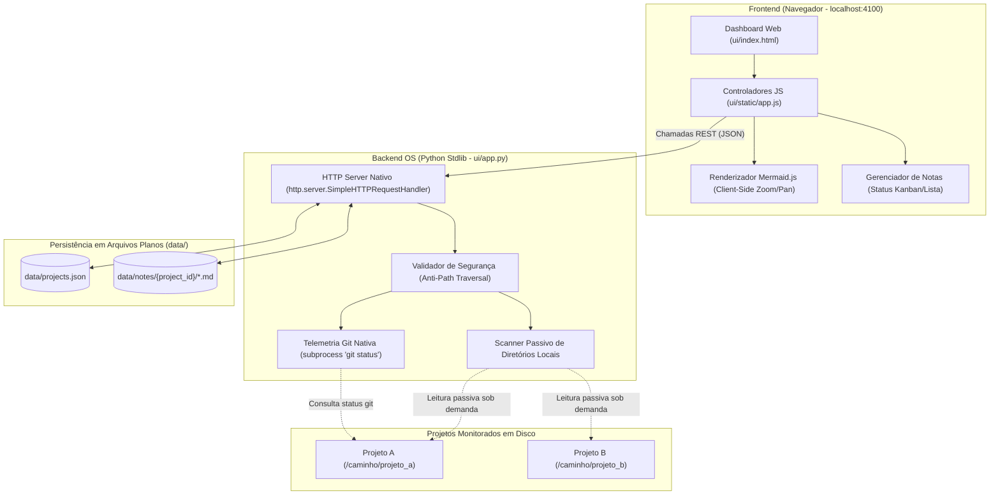
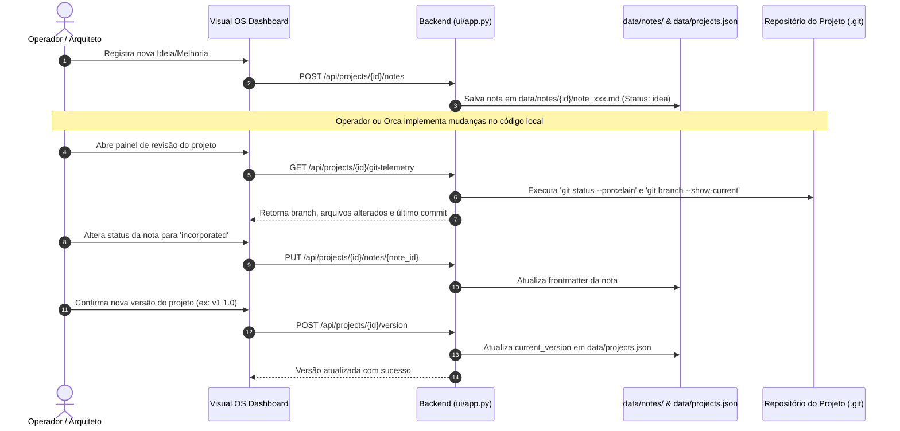

# Documento de Design Técnico: Nexus Cockpit (Local Project OS)

* **Status:** Aprovado e Remediado (Pós-Revisão EGM) — Evoluído para Nexus Cockpit (veja [vault_observability_and_entity_cockpit.md](vault_observability_and_entity_cockpit.md))
* **Autor:** Sandro Freitas
* **Data:** 2026-10-30
* **Relatório de Auditoria:** [docs/reviews/README.md](../reviews/README.md)

---

## 1. O Problema

Desenvolvedores e arquitetos lidam com múltiplos projetos de software distribuídos localmente em disco. Hoje, a visualização técnica desses projetos sofre de três problemas centrais:

1. **Fragmentação e Falta de Observabilidade Consolidada**: Para inspecionar a arquitetura, o fluxo de dados e os esquemas de banco de dados de cada projeto, o operador precisa navegar manualmente entre diretórios, abrir repositórios isolados e decifrar arquivos dispersos. Falta uma visão unificada para acompanhar a frota local de projetos.
2. **Risco de Stale Documentation e Duplicação**: Criar um portal centralizado que replique manualmente especificações ou códigos gera uma segunda fonte da verdade. Essa abordagem resulta em drift (dessincronização entre a documentação do portal e o código real).
3. **Falta de Rastreabilidade Pré-Versão para Melhorias**: Ideias, débitos técnicos e notas de revisão costumam poluir commits provisórios ou branches não homologadas nos projetos de destino, ou se perdem em anotações soltas antes de serem formalmente incorporadas e receberem uma nova versão.

Além disso, a estrutura atual deste repositório (`skills-library`) possui scripts e ferramentas acoplados a um modelo de sincronização centralizada de skills multi-LLM (`sync_skills.py`, `catalog.json`), o qual tornou-se obsoleto com a delegação descentralizada de skills para o ambiente global de cada agente e a orquestração externa conduzida pelo Orca.

---

## 2. Visão Geral

O **Local Project OS** transforma este repositório em um console operacional e visual para gerenciamento e observabilidade arquitetural da frota de projetos locais. 

O sistema opera sob o **Princípio do Observador Passivo (Zero-Dependencies & Zero-Drift)**:
- **Leitura Passiva em Disco**: Monitora os projetos a partir de seus caminhos absolutos no sistema de arquivos local, lendo arquivos de documentação sob demanda em tempo real (<1ms em SSD local), sem persistir resumos em cache para garantir zero drift.
- **Renderização Gráfica Client-Side**: O backend entrega o conteúdo Markdown bruto e o navegador (Mermaid.js) renderiza os fluxogramas operacionais e diagramas relacionais (ERD) interativamente com controles de zoom e navegação.
- **Ledger de Melhorias Desacoplado**: Centraliza o registro de ideias e débitos técnicos por projeto em arquivos Markdown ou no cadastro do OS, mantendo rascunhos fora da árvore de commits do repositório monitorado.
- **Telemetria Git Nativa**: Exibe o status do repositório (branch ativo, arquivos modificados e commits recentes) via telemetria Git nativa para validação humana antes da atualização de versão.
- **Desacoplamento de Runtimes de IA (Fronteira com o Orca)**: O Project OS **não** executa comandos, não orquestra agentes nem embarca SDKs de LLM. O **Orca** atua estritamente como um agente/orquestrador CLI externo operado pelo usuário no terminal; o Project OS atua apenas como a interface visual e operacional de acompanhamento.
- **Expurgo do Legado**: Desvincula e remove completamente toda a infraestrutura legada de catálogo de skills deste repositório.

---

## 3. Objetivos e Não-Objetivos

### 3.1. Objetivos
* **G1 - Registro Descentralizado de Projetos**: Permitir registrar caminhos de projetos locais em disco e visualizá-los em uma interface web única.
* **G2 - Ingestão Passiva em Tempo Real (Zero Drift)**: Ler documentações de projetos sob demanda no sistema de arquivos local, sem camadas de cache estático que fiquem defasadas.
* **G3 - Renderização Gráfica Interativa**: Renderizar diagramas de banco de dados e fluxos operacionais client-side em Mermaid.js com tratamento de erros visuais e suporte a zoom/pan.
* **G4 - Ledger de Melhorias e Ideias Desacoplado**: Manter anotações de melhoria com ciclo de vida padronizado (`idea`, `planned`, `in_review`, `incorporated`) fora da árvore de commits dos projetos monitorados.
* **G5 - Visibilidade de Telemetria Git**: Exibir o status Git local do projeto (branch, arquivos modificados e hash recente) para apoio à decisão de incremento de versão.
* **G6 - Zero Dependências Externas no Backend**: O servidor local deve rodar exclusivamente com a biblioteca padrão do Python (`http.server`), sem necessidade de `pip install`, FastAPI ou virtualenvs.
* **G7 - Limpeza Definitiva do Legado de Skills**: Expurgar completamente scripts de sincronização, validação de catálogo e skills globais deste repositório.

### 3.2. Não-Objetivos
* **NG1 - Execução ou Orquestração de Agentes**: O OS não executa comandos nem controla runtimes de LLM; qualquer operação de IA é executada externamente pelo operador ou pelo Orca no terminal.
* **NG2 - Edição Direta de Código de Produção**: O OS não funciona como IDE web nem modifica diretamente o código-fonte dos projetos monitorados.
* **NG3 - Conexões Diretas a Bancos de Produção**: O sistema não se conecta a bancos de dados vivos (PostgreSQL, MySQL, etc.); esquemas são interpretados a partir de arquivos documentais e diagramas Mermaid.
* **NG4 - Banco de Dados Interno no OS**: O OS não utiliza SQLite, PostgreSQL ou MongoDB; a persistência é estritamente em arquivos planos (`data/projects.json` e Markdown).
* **NG5 - Biblioteca Canônica de Skills**: Este repositório deixa de ser um catálogo centralizado de skills.

---

## 4. Plano Técnico

### 4.1. Arquitetura de Alto Nível



### 4.2. Ingestão Passiva de Documentação e Tratamento de Erros

A descoberta de documentos ocorre sob demanda na requisição, sem cache intermediário:

1. **Detecção Heurística de Arquivos de Arquitetura**:
   - O scanner procura os seguintes arquivos na raiz ou na pasta `docs/` do projeto monitorado:
     - `ARCHITECTURE.md` ou `docs/ARCHITECTURE.md` (formato consolidado preferencial)
     - `TECHSPEC.md` ou `docs/TECHSPEC.md`
     - `WORKFLOWS.md` ou `docs/WORKFLOWS.md`
     - `DATABASE.md` ou `docs/DATABASE.md` / `SCHEMA.md`
     - `README.md` (fallback automático para apresentação de visão geral)
2. **Extração de Blocos Mermaid**:
   - O backend lê o conteúdo dos arquivos e extrai blocos de código com linguagem ````mermaid (diagramas de fluxo e esquemas `erDiagram`).
3. **Tratamento de Erros Client-Side (Error Boundary)**:
   - O Mermaid.js renderiza os diagramas diretamente no cliente.
   - Caso um bloco contenha erro de sintaxe, o frontend não quebra: exibe uma caixa de aviso indicando a falha de renderização com a linha aproximada e fornece um botão para alternar e inspecionar o Markdown bruto original.

### 4.3. Ciclo de Vida de Melhorias e Telemetria Git

O gerenciamento de ideias é mantido desacoplado dos repositórios locais monitorados.



### 4.4. Especificação de Contratos de API REST

O backend local em `ui/app.py` expõe endpoints REST restritos a conexões locais (`127.0.0.1`):

| Método | Endpoint | Descrição | Status HTTP |
|---|---|---|---|
| `GET` | `/api/projects` | Lista todos os projetos registrados em `projects.json` | `200 OK` |
| `POST` | `/api/projects` | Registra novo projeto (valida `os.path.realpath` e `path.is_dir()`) | `201 Created` / `400 Bad Request` |
| `DELETE` | `/api/projects/{id}` | Desvincula o projeto do registro do OS (não remove a pasta) | `200 OK` / `404 Not Found` |
| `GET` | `/api/projects/{id}/docs` | Retorna o conteúdo lido sob demanda dos arquivos Markdown e blocos Mermaid | `200 OK` / `404 Not Found` |
| `GET` | `/api/projects/{id}/git-telemetry` | Retorna telemetria Git (branch, modified_files, commits) | `200 OK` / `404 Not Found` |
| `GET` | `/api/projects/{id}/notes` | Retorna a lista de notas do projeto | `200 OK` |
| `POST` | `/api/projects/{id}/notes` | Cria nova nota de melhoria | `201 Created` / `400 Bad Request` |
| `PUT` | `/api/projects/{id}/notes/{note_id}` | Atualiza título, status ou conteúdo de uma nota | `200 OK` / `404 Not Found` |
| `DELETE` | `/api/projects/{id}/notes/{note_id}` | Remove uma nota de melhoria | `200 OK` / `404 Not Found` |
| `POST` | `/api/projects/{id}/version` | Atualiza o registro de versão do projeto | `200 OK` / `400 Bad Request` |

### 4.5. Esquemas de Persistência em Arquivos Planos

#### 1. `data/projects.json`
```json
[
  {
    "id": "project-example",
    "name": "Project Example",
    "path": "C:/Docker/project-example",
    "current_version": "v1.0.0",
    "created_at": "2026-10-30T14:00:00Z",
    "tags": ["python", "api"]
  }
]
```

#### 2. `data/notes/{project_id}/note_001.md`
```markdown
---
id: note-001
title: Otimizar pooling de conexões
status: idea # idea | planned | in_review | incorporated
created_at: 2026-10-30T14:10:00Z
target_files:
  - "database.py"
  - "config.py"
version_target: "v1.1.0"
---

### Descrição e Motivação
Ajustar o limite de conexões simultâneas para evitar saturação.
```

---

## 5. Alternativas Consideradas

### 5.1. Embarcar LLM no Backend para Normalização Automática
* **Motivo da Rejeição:** Viola o princípio de fronteira (NG1), exige gerenciamento de chaves de API, SDKs pesados e introduz falhas de rede em um visualizador local.
* **Decisão:** O backend é estritamente passivo; a geração de documentação em Markdown é executada externamente pelo operador ou pelo Orca.

### 5.2. Persistência de Cache de Resumos (`_summary.json`)
* **Motivo da Rejeição:** Gera drift inevitável entre os arquivos do projeto e a visão do OS. Como a leitura local de arquivos Markdown é quase instantânea (<1ms), o cache era uma otimização prematura danosa.
* **Decisão:** Leitura direta sob demanda dos arquivos no sistema de arquivos local.

### 5.3. Migração para Framework FastAPI
* **Motivo da Rejeição:** Adiciona dependências de empacotamento (`pip install fastapi uvicorn pydantic`), quebrando a facilidade de iniciar o servidor com `python ui/app.py` nativo.
* **Decisão:** Manter a biblioteca padrão do Python (`http.server` e `socketserver`).

### 5.4. Motor de Reconciliação com Diff Automático de Texto Livre
* **Motivo da Rejeição:** Comparar semanticamente textos livres com diffs de Git de forma programática é especulativo e falho.
* **Decisão:** Reutilizar a telemetria Git nativa (`get_git_telemetry`) para apoiar a homologação humana.

---

## 6. Plano Detalhado de Implementação

### 6.1. Fase 1: Expurgo do Legado de Skills
Remoção completa dos componentes e automações da antiga biblioteca de skills.

* **Arquivos a Excluir**:
  - `scripts/sync_skills.py`
  - `catalog.json`
  - `templates/SKILL_TEMPLATE.md`
  - Diretório `global/` (todas as pastas de skills globais legadas)
  - `.github/workflows/validate.yml`
  - `ui/fleet.json` (substituído por `data/projects.json`)

### 6.2. Fase 2: Estrutura de Dados e Templates de Convenção
* **Arquivos a Criar**:
  - `data/projects.json`: Inicializado com `[]`.
  - `data/notes/.gitkeep`: Diretório base para notas por projeto.
  - `templates/convention/ARCHITECTURE.template.md`: Template padrão com seções de Visão Geral, Techspec, Workflows (Mermaid `flowchart`) e Banco de Dados (Mermaid `erDiagram`).
  - `templates/convention/NOTE.template.md`: Template com frontmatter canônico para notas (`id`, `title`, `status`, `target_files`, `version_target`).

### 6.3. Fase 3: Módulos de Inspeção e Telemetria no Backend
* **Arquivos a Criar/Modificar**:
  - `ui/scanner.py`: Módulo auxiliar para varrer a pasta de um projeto, sanitizar caminhos (`os.path.realpath`), verificar existência de documentação e extrair blocos de texto e Mermaid.
  - Reutilização e refinamento de `get_git_telemetry(project_path)` em `ui/app.py` para inspecionar branch e alterações locais com fallback seguro quando não for um repositório Git.

### 6.4. Fase 4: Refatoração das Rotas REST no Servidor
* **Arquivos a Modificar**:
  - `ui/app.py`:
    - Limpar imports e rotas legadas de `sync_skills` e `catalog.json`.
    - Remover restrição `is_internal_project` e implementar validação segura de caminhos (`is_valid_project_path`).
    - Implementar endpoints REST especificados na Seção 4.4 (`/api/projects`, `/api/projects/{id}/docs`, `/api/projects/{id}/git-telemetry`, `/api/projects/{id}/notes`, `/api/projects/{id}/version`).
    - Garantir que o servidor faça bind seguro estritamente em `127.0.0.1:4100`.

### 6.5. Fase 5: Dashboard Visual (Frontend, Mermaid e CSS)
* **Arquivos a Modificar**:
  - `ui/index.html`:
    - Atualizar título e estrutura para "Project OS".
    - Adicionar seletor de projetos com badge de telemetria Git.
    - Estruturar abas: Arquitetura/Techspec, Workflows, Banco de Dados, Notas de Melhoria.
    - Modal para registrar novo projeto via caminho em disco.
  - `ui/static/app.js`:
    - Remover módulos legados de skills (`initHub`, `initStudio`, pesquisa de catálogo).
    - Implementar novos controladores: `initProjects`, `loadProjectDocs`, `renderMermaidBlocks`, `initNotesManager`, `updateProjectVersion`.
    - Implementar tratamento de erro e alternador de visualização (gráfico vs. markdown bruto).
  - `ui/static/styles.css`:
    - Ajustar estilos para visualização em tela cheia dos diagramas, controles de zoom/pan, cards de notas por status e badges de Git.

### 6.6. Fase 6: Governança, Documentação e Validação
* **Arquivos a Modificar/Criar**:
  - `README.md`: Substituir todo o conteúdo por instruções completas de uso do Project OS, convenção de arquivos e fluxo de trabalho.
  - `tests/test_server.py`: Teste unitário para validar endpoints REST básicos e proteção contra path traversal.
  - `.github/workflows/ci.yml`: Workflow simples para execução automática dos testes em Python 3.
  - `.gitignore`: Atualizar para ignorar `__pycache__` e arquivos temporários.
