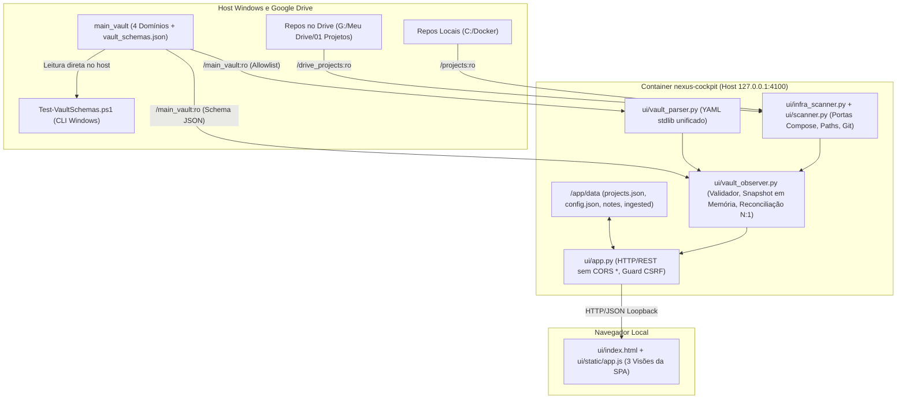

# Nexus Cockpit — Observabilidade do Main Vault e Visão Consolidada por Entidade

* **Author:** @salmeida
* **Status:** Implementado e Verificado (Pós-Revisão EGM — Arquitetura Snapshot em Memória)
* **Date:** 2026-11-13
* **Audit Report:** [docs/reviews/vault_observability/consolidated_review_report.md](../reviews/vault_observability/consolidated_review_report.md)

---

## Overview

Este documento define a arquitetura e o plano de implementação para expandir o `nexus-cockpit` (`C:\Docker\nexus-cockpit`) como painel web de observabilidade somente leitura sobre as quatro pastas de domínio do `main_vault` (`01_Projetos`, `02_Recursos_e_Infra`, `04_Arquitetura_ADRs` e `05_Areas`), consolidando a leitura por entidade (`Pessoal`, `Axion Skill`, `SIAE BR`, `Igreja ICENV`, além da visão agregada `"Todas"` na interface).

A solução mantém os arquivos Markdown do `main_vault` como única fonte da verdade e adota um **snapshot imutável em memória** (trocado atomicamente sob `threading.Lock`, sem banco de dados local), preservando integralmente o não-objetivo `NG4` (*Zero Persistent Database*: proibição de banco de dados relacional/vetorial no cockpit) e o princípio `Zero Drift` (nenhuma divergência entre estado exibido em tela e arquivos reais no disco, emendado apenas para exibir o horário da última captura quando o índice estiver em cache), definidos em [local_project_os.md](./local_project_os.md) e [infra_and_subsystems_catalog.md](./infra_and_subsystems_catalog.md). O sistema adota um manifesto JSON compartilhado (`vault_schemas.json`) entre o validador PowerShell do vault ([Test-VaultSchemas.ps1](file:///G:/Meu%20Drive/main_vault/scripts/harness/Test-VaultSchemas.ps1)) e o backend Python, conclui a mudança de identidade definida pela `ADR-008` (*Brain Pessoal Multi-Cliente*, que formalizou as 4 entidades desacoplando `Axion Skill` de `SIAE BR` e renomeou o sistema para `Nexus`) e aplica endurecimento de rede local.

---

## The Problem

Atualmente há quatro lacunas operacionais entre o console web (`nexus-cockpit`) e o repositório de documentação no Google Drive (`main_vault`):

1. **Visibilidade parcial do `main_vault` no console:** O `docker-compose.yml` monta apenas `02_Recursos_e_Infra:/vault:ro`, deixando `01_Projetos`, `04_Arquitetura_ADRs` e `05_Areas` sem leitura na interface web. Não há visão consolidada por entidade/cliente conectando projetos do vault, ADRs, infraestrutura e repositórios Git locais.
2. **Descompasso de identidade e vínculo frágil com repositórios:** Apesar da [ADR-008](file:///G:/Meu%20Drive/main_vault/04_Arquitetura_ADRs/ADR-008_Brain_Pessoal_Multi_Cliente_e_Subagentes.md) ter definido o nome `Nexus` (`Pessoal`), o código, a interface, `data/projects.json`, `docker-compose.yml` e `ui/scanner.py` ainda mantêm referências a `axion-cockpit` e `AXION_VAULT_*`. Em `01_Projetos/`, há vínculos N:1 com repositórios (`SIAEBR_Project.md` e `SIAEBR_MatPlan.md` apontando para `Project_Siaebr`) e repositórios em `G:\Meu Drive\01 Projetos\*` ficam fora do mount `/projects:ro`, impedindo telemetria Git.
3. **Validação fragmentada e parsers YAML divergentes:** O `Test-VaultSchemas.ps1` roda apenas via PowerShell no host e não valida `04_Arquitetura_ADRs`, enquanto o cockpit possui dois parsers YAML manuais diferentes (`ui/infra_scanner.py` e `ui/app.py`) que não tratam UTF-8 BOM, escape de `\\`/`\"`, listas inline ou frontmatter ausente, e descartam erros de leitura.
4. **Exposição local e coleta síncrona no healthcheck:** O container atual expõe `0.0.0.0:4100` com `Access-Control-Allow-Origin: *` (inclusive em respostas `OPTIONS`), valida frouxamente rotas mutáveis de configuração (`POST /api/infra/config`) e aponta o `HEALTHCHECK` a cada 30s para `GET /api/projects`, disparando subprocessos `git` síncronos por projeto. Ao incluir `05_Areas` (que armazena memoriais institucionais e financeiros sensíveis), expor a API sem restrição de loopback, proteção contra CSRF e projeção fechada de campos criaria risco direto de vazamento.

---

## Goals

* **G1 — Visão Consolidada por Entidade:** Exibir na interface um filtro por entidade (`Pessoal`, `Axion Skill`, `SIAE BR`, `Igreja ICENV` e filtro agregado `Todas`) reunindo itens dos 4 domínios do vault (`01_Projetos`, `02_Recursos_e_Infra`, `04_Arquitetura_ADRs` e metadados de `05_Areas`) com indicadores numéricos de conformidade e vínculos.
* **G2 — Contrato Único (`vault_schemas.json`) e Parser YAML Unificado:** Substituir os dois parsers manuais por um parser único stdlib (com tratamento de UTF-8 BOM, escapes `\\` e `\"` simétricos com a escrita de notas, comentários `#` fora de aspas e listas inline/multiline, sem injetar defaults falsos) validado contra `vault_schemas.json` compartilhado entre `Test-VaultSchemas.ps1` e Python.
* **G3 — Snapshot Imutável em Memória com Frescor Visível:** Manter os metadados validados, erros de varredura (`scan_errors`) e telemetria Git em um snapshot imutável em memória protegido por `threading.Lock` (com invalidação composta de cache), exibindo `last_indexed_at`, `vault_status` (`available` | `unavailable` | `schema_error` | `initializing`) e botão manual de reindexação na interface.
* **G4 — Vínculo Determinístico N:1 e Matriz Limitada de Divergência:** Ligar fichas de `01_Projetos` aos repositórios locais por caminho canônico normalizado de `repositorio_local` (suportando múltiplos módulos por repositório e entradas `ingested: true` de `data/projects.json`), distinguindo `non_path_reference` e `not_mounted_in_runtime`, e restringindo alertas a 4 condições binárias objetivas.
* **G5 — Isenção de Idade para ADRs/Áreas e Privacidade de `05_Areas`:** Não gerar alertas de obsolescência por idade em `04_Arquitetura_ADRs` e `05_Areas`, e garantir por projeção fechada hardcoded em Python que nenhum endpoint retorne o corpo textual ou campos não autorizados de `05_Areas`.
* **G6 — Saneamento de Identidade, Hardening e Healthcheck Leve:** Concluir a migração `axion-cockpit` → `nexus-cockpit` (preservando fallback compatível para variáveis `AXION_VAULT_*`), restringir o bind Docker para `127.0.0.1:4100`, remover `CORS: *` (incluindo `OPTIONS`), validar requisições mutáveis contra CSRF e redirecionar o `HEALTHCHECK` para `GET /api/status`.

## Non-Goals

* **NG-A — Execução de Agentes, LLMs ou Automações:** O `nexus-cockpit` não dispara subagentes, comandos CLI, prompts ou fluxos `n8n`.
* **NG-B — Escrita no `main_vault` ou nos Repositórios Monitorados:** Nenhuma rota web cria, edita ou move arquivos no `main_vault` ou nos repositórios de projetos.
* **NG-C — Conexão Direta a Bancos Externos de Clientes:** O cockpit não abre conexões TCP/SQL com bancos de clientes ou sistemas pessoais (PostgreSQL SIAE BR, Supabase ICENV, Postgres Finanças/Obras via VPN `192.18.10.20` ou apontadores de dados / *data pointers* descritos no estudo do Infinity OS), nem armazena credenciais externas.
* **NG-D — Adoção da Taxonomia `_system/` do `infinite-brain-os`, Dependências `pip` ou Banco Persistente (`NG4`):** Não serão importados arquivos de controle de `starmynd-org/infinite-brain-os`, não serão adicionadas dependências externas (`pip install`, `PyYAML`, `pgvector`) e o índice permanecerá estritamente em memória sem persistência SQL (`sqlite3`).
* **NG-E — Auto-Mutação de Status:** O sistema nunca reescreve `status` no frontmatter do vault nem em `data/projects.json` a partir de heurísticas Git.

---

## Critical User Journeys (CUJs)

### CUJ 1: Consulta Consolidada por Entidade no Cockpit

* **Dado:** O container do `nexus-cockpit` está em execução em `127.0.0.1:4100` com `/main_vault:ro` montado e o snapshot inicial carregado em memória.
* **Quando:** O operador acessa a aba `🧠 Vault & Entidades` e seleciona `SIAE BR` (ou `Pessoal`, `Axion Skill`, `Igreja ICENV`, `Todas`).
* **Então:** A interface exibe projetos (`01_Projetos`), recursos de infraestrutura (`02_Recursos_e_Infra`), ADRs (`04_Arquitetura_ADRs`) e apenas metadados autorizados de áreas (`05_Areas`) vinculados à entidade selecionada, exibindo contadores de conformidade, vínculos N:1 (`SIAEBR_Project` e `SIAEBR_MatPlan` ligados a `Project_Siaebr`) e `last_indexed_at`, sem nunca expor o corpo Markdown de `05_Areas`.

### CUJ 2: Auditoria de Contratos e Isenção de Idade

* **Dado:** O `main_vault` contém uma ADR aprovada com data de 6 meses atrás em `04_Arquitetura_ADRs/`, uma nota institucional sem frontmatter em `05_Areas/` e um projeto em `01_Projetos/` com campo obrigatório ausente segundo `vault_schemas.json`.
* **Quando:** O operador aciona a reindexação manual ou abre a visão de auditoria na aba do vault.
* **Então:** O painel registra erro de contrato no projeto com campo ausente, registra o aviso não bloqueante `non_contract_markdown` para a nota sem frontmatter em `05_Areas/` conforme a política do manifesto, e exibe a ADR aprovada como conforme sem nenhum alerta de idade.

### CUJ 3: Detecção Limitada de Divergência Vault ↔ Git / Docker Compose

* **Dado:** O vault possui `Categorizador_Code.md` (`status: "Arquivado"`, `repositorio_local: "Incorporado em G:\\Meu Drive\\01 Projetos\\Finaceiro_pessoal"`), `ICENV_Site.md` (`status: "Produção"`) e `HomeLab_Server.md` (`repositorio_local: "Notebook Dell (192.168.15.176)"`).
* **Quando:** O reconciliador cruza `01_Projetos` com `data/projects.json`, os repositórios locais montados e seus `docker-compose.yml`.
* **Então:** `HomeLab_Server.md` e `Categorizador_Code.md` recebem `link_state: "non_path_reference"` (sem erro de caminho nem falso alerta de arquivo morto); se `ICENV_Site.md` tiver alterações não comitadas, exibe apenas o selo informativo `is_dirty`; e somente violações binárias da matriz geram alerta de divergência.

### CUJ 4: Degradação Graciosa com Google Drive ou Mount Indisponível

* **Dado:** O servidor já carregou um snapshot válido em memória, mas o Google Drive (`G:\`) é desmontado ou o diretório `/drive_projects` está vazio/não montado no container Linux.
* **Quando:** O operador acessa o cockpit, dispara uma reindexação ou o Docker executa o `HEALTHCHECK` (`GET /api/status`).
* **Então:** `GET /api/status` responde `200` sem bloquear em I/O, o último snapshot válido permanece preservado em memória sinalizando `vault_status: "unavailable"` (com os repositórios não montados classificados como `not_mounted_in_runtime`), sem apagar os dados anteriores.

---

## Technical Plan (Architecture)

### 1. Arquitetura Geral e Fronteira de Dados

O `nexus-cockpit` opera sobre duas fronteiras isoladas e mantidas separadas no sistema de arquivos do container:

1. **Observabilidade Read-Only (`main_vault` e Repositórios):**
   * `/main_vault:ro` (configurado via `NEXUS_VAULT_HOST_DIR`) fornece o acesso ao `main_vault`. O scanner aplica uma lista fechada em Python permitindo apenas os 4 domínios (`01_Projetos`, `02_Recursos_e_Infra`, `04_Arquitetura_ADRs`, `05_Areas`) e o manifesto `scripts/harness/vault_schemas.json`. Diretórios e arquivos como `.agents/`, `.obsidian/`, `.git/`, `chaves_ssh/`, qualquer nome iniciado por `.` e arquivos `.env*` são bloqueados antes de qualquer leitura ou resolução de symlinks.
   * `/projects:ro` (repositórios locais do host em `C:\Docker`) e `/drive_projects:ro` (repositórios em `G:\Meu Drive\01 Projetos`) são montados em somente leitura para inspeção de documentos de projeto, manifestos Docker Compose e telemetria Git.
2. **Estado Local do Cockpit (`data/`):**
   * Armazena `data/projects.json` (catálogo local de projetos monitorados), `data/config.json` (configuração local persistida de caminho do vault de infraestrutura, validada contra a allowlist), `data/ingested/` (cópias locais de documentação enviadas pelo navegador quando o projeto não está montado no container) e `data/notes/{project_id}/*.md` (anotações de melhoria do próprio cockpit), totalmente separado da escrita no `main_vault`.



### 2. Contrato Único (`vault_schemas.json`) e Parser YAML Unificado

* **Localização e resolução:** O manifesto canônico fica em `main_vault/scripts/harness/vault_schemas.json` (com override opcional `NEXUS_SCHEMA_PATH` para testes/CI). Tanto `Test-VaultSchemas.ps1` (`ConvertFrom-Json`) quanto `ui/vault_observer.py` (`json`) consomem exatamente o mesmo arquivo.
* **Separação de responsabilidades (Segurança vs. Schema):** O `vault_schemas.json` define apenas regras estruturais de contrato dos arquivos Markdown. Regras de segurança e privacidade (allowlist das 4 pastas, bloqueio de `chaves_ssh`/arquivos ocultos/symlinks fora da raiz e projeção fechada de campos de `05_Areas` sem corpo textual) ficam **fixas no código Python** e não podem ser flexibilizadas pelo JSON. Da mesma forma, o manifesto não declara flags sem consumidor (`age_policy` / `age_exempt`) nem misturas de opção de filtro de UI (`"Todas"`) na lista de entidades monitoradas.
* **Estrutura exata de `vault_schemas.json`:**
  * `schema_version`: `"1.0.0"`.
  * `entities`: `["Pessoal", "Axion Skill", "SIAE BR", "Igreja ICENV"]` (entidades individuais monitoradas no cockpit).
  * `allowed_entity_values`: `["Pessoal", "Axion Skill", "SIAE BR", "Igreja ICENV", "Todas", "SIAE BR & Pessoal"]` (valores aceitos no frontmatter das notas; `"SIAE BR & Pessoal"` associa-se a ambas as entidades e `"Todas"` é considerada transversal às 4).
  * `global_rules`:
    * `allowed_extensions`: `[".md"]` (arquivos binários como `.pdf` e `.jpg` são ignorados pela extensão antes do parsing);
    * `max_file_bytes`: `524288` (512 KB por arquivo `.md`; arquivos acima geram erro estruturado `file_too_large` sem leitura integral);
    * `forbid_empty_bytes`: `true`;
    * `forbid_absolute_wikilink_regex`: `"\[\[[A-Za-z]:[\\/].*?\]\]"` aplicado após remoção de blocos cercados por `` ``` `` e inline `` ` `` (mantendo paridade com `Test-VaultSchemas.ps1`).
  * `domains`:
    * **`01_Projetos` (`domain: "projects"`):**
      * `recursive: true`, `ignored_filenames: ["README.md", "_Template_Projeto.md"]`, `ignored_prefixes: ["_Template_"]`, `non_frontmatter_policy: "error"`.
      * `required_fields`: `["projeto", "entidade", "status"]`.
      * `optional_fields`: `["tipo", "stack", "repositorio_local", "github_repo", "deploy_target", "url_producao", "url_homologacao", "banco_dados", "portas", "skills_utilizadas", "tags", "cockpit_id"]`.
      * `allowed_enums.status`: `["Produção", "Producao", "Em Desenvolvimento", "Planejamento", "Arquivado"]`.
      * `allowed_enums.entidade`: referência a `allowed_entity_values`.
    * **`02_Recursos_e_Infra` (`domain: "infra"`):**
      * `recursive: true`, `ignored_filenames: ["README.md"]`, `spec_doc_filenames: ["HOME_LAB_SPECIFICATIONS.md", "Oracle.md"]`, `non_frontmatter_policy: "error"`.
      * Notas de especificação listadas em `spec_doc_filenames` exigem `["titulo", "tipo", "entidade"]` no contrato e são excluídas da listagem de hosts/portas de `/api/infra` (reconciliando `ui/infra_scanner.py` e `Test-VaultSchemas.ps1`).
      * Demais notas de recurso exigem `required_fields: ["recurso", "tipo", "entidade", "status"]`; `optional_fields`: `["host", "hostname", "ip_publico", "ip_privado", "os", "shape", "ocpu", "ram", "hardware", "cpu", "armazenamento", "dominio_principal", "ssh_alias", "usuario_ssh", "diretorio_projeto", "servicos_ativos", "servicos_planejados", "subdominios_ativos", "ferramentas_instaladas", "diretorios_principais", "tags"]`.
      * `allowed_enums.status`: `["Ativo / Produção", "Ativo / Desenvolvimento", "Ativo / PaaS Pronto", "Ativo", "Em Manutenção", "Desativado"]`.
    * **`04_Arquitetura_ADRs` (`domain: "adrs"`):**
      * `recursive: true`, `ignored_filenames: ["README.md"]`, `non_frontmatter_policy: "error"`.
      * `required_fields`: `["adr", "titulo", "data", "status", "entidade", "contexto"]`.
      * `optional_fields`: `["tags", "substituida_por"]`.
      * `allowed_enums.status`: `["Proposto", "Aprovado / Implementado", "Substituído", "Rejeitado", "Depreciado"]`.
      * Regra adicional: quando `status == "Substituído"`, emite aviso `missing_superseding_ref` se nem `substituida_por` nem menção/link a outra `ADR-\d{3}` estiver presente.
    * **`05_Areas` (`domain: "areas"`):**
      * `recursive: true`, `ignored_filenames: ["README.md", "00_INDICE_AREAS.md", "_Template_Cliente_SIAEBR.md"]`, `ignored_prefixes: ["_Template_"]`, `non_frontmatter_policy: "warning_non_contract"`.
      * Notas sem frontmatter recebem aviso não bloqueante `non_contract_markdown` e são contabilizadas como `frontmatter_status: "missing"`.
      * Notas com frontmatter exigem `required_fields: ["area", "entidade", "tipo", "caminho_drive"]`; `optional_fields`: `["cliente", "aliases", "segmento", "status", "status_conta", "programas_ativos", "modelos_homologados", "tags"]`.
      * Validação de `caminho_drive`: no Windows (`Test-VaultSchemas.ps1`), continua testando acesso local via `Test-Path`; no runtime Linux do container, valida sintaxe não vazia `^([A-Za-z]:\\|/)` e classifica `links_status: "not_mounted_in_runtime"` sem acusar erro de contrato.

* **Parser YAML Unificado (`ui/vault_parser.py`) e Compatibilidade:**
  * Expõe `parse_frontmatter(content: str) -> Dict[str, Any]` (compatível com o contrato legado de `infra_scanner.parse_yaml_frontmatter`, retornando `{}` quando ausente ou não fechado) e `parse_frontmatter_strict(content: str) -> Tuple[Dict[str, Any], str, Optional[str]]` retornando `(data, frontmatter_status, error_detail)` onde `frontmatter_status in ("ok", "missing", "malformed")` sem injetar chaves padrão artificiais.
  * Regras de parsing: remove UTF-8 BOM (`\ufeff`); localiza delimitadores `---` apenas em linhas isoladas; desescapa `\\` e `\"` em strings entre aspas duplas; preserva `\\` literais em strings com aspas simples e desescapa `''`; ignora `#` apenas fora de strings; suporta listas inline (`[a, b]`), listas multiline (`- item`) e escalares de bloco (`|` e `>`); em chaves duplicadas adota último valor (registrando aviso em modo estrito) e em chaves aninhadas não suportadas registra erro `unsupported_nested_yaml` em vez de corromper chaves pai.
  * `write_markdown_note` em `ui/app.py` passa a escapar `\` (`\\`) e `"` (`\"`) ao gravar escalares e itens entre aspas duplas, garantindo roundtrip exato com `parse_frontmatter`; `parse_markdown_note` em `ui/app.py` delega ao parser unificado aplicando apenas localmente os defaults de notas do cockpit (`id`, `title`, `status: "idea"`, `created_at`, `target_files`, `version_target`, `content`).

### 3. Snapshot Imutável em Memória, Ciclo de Boot e Unificação com `infra_scanner.py`

* **Fim da duplicação de pipeline:** Em vez de manter dois scanners concorrentes, `ui/vault_observer.py` reutiliza diretamente `infra_scanner.extract_compose_ports_from_content` e `infra_scanner.detect_port_collisions` e produz o snapshot unificado que alimenta **tanto** `/api/vault/*` quanto `/api/infra` (com wrapper retrocompatível em `ui/infra_scanner.py`). `infra_scanner.scan_infrastructure_directory` e `parse_yaml_frontmatter` permanecem funcionais para chamadas isoladas e testes unitários existentes usando o parser unificado.
* **Ciclo de boot e concorrência:**
  * `create_server(...)` inicializa imediatamente um snapshot inicial seguro (`vault_status: "initializing"`, contadores zerados) antes de abrir o socket TCP para que `GET /api/status` responda `200` em menos de 50 ms dentro do `start_period: 5s` do `HEALTHCHECK`. Uma thread daemon dispara o primeiro scan sob `threading.Lock` (em testes automatizados, `warmup=True` ou injeção síncrona preenche imediatamente).
  * Reindexação protegida por `threading.Lock` com flag *single-flight* / evento de conclusão: requisições concorrentes a `POST /api/vault/reindex` aguardam a varredura em curso e recebem o mesmo snapshot recém-construído, evitando leituras simultâneas no Google Drive.
  * Leitura HTTP (`GET /api/status`, `/api/vault/*`, `/api/infra`) apenas lê a referência atômica do último `VaultSnapshot` imutável em memória, sem executar `git` nem varrer o filesystem no caminho da requisição (inclusive `GET /api/projects` passa a consumir a telemetria Git em cache quando recente ou sob refresh controlado, evitando `git` síncrono no hot path).
* **Invalidação composta e degradação graciosa:**
  * Cache por arquivo `.md` usa chave `(rel_path, size_bytes, mtime_ns)` e hash SHA-256 do conteúdo para evitar re-parse desnecessário, porém a invalidação global do snapshot verifica também: SHA-256 de `vault_schemas.json`, hash/mtime de `data/projects.json`, mtime/hash dos `docker-compose.yml`/`yaml` dos projetos vinculados e estado de `.git/HEAD` e `.git/index` dos repositórios acessíveis.
  * Se `/main_vault` ou `vault_schemas.json` estiver inacessível ou inválido durante uma reindexação, a tentativa atualiza apenas os campos de estado da última tentativa (`vault_status: "unavailable"` ou `"schema_error"` + `last_error`) e **preserva integralmente** os nós, vínculos e `scan_errors` do último snapshot válido em memória.
* **Estrutura do Snapshot e Política de Privacidade de `05_Areas`:**
  * Cada item em `vault_nodes` contém: `rel_path`, `domain` (`projects` | `infra` | `adrs` | `areas`), `entity`, `title`, `doc_type`, `status`, `frontmatter_status`, `validation_errors`, `links_status` (`accessible` | `not_mounted_in_runtime` | `non_path_reference` | `missing_on_disk` | `not_applicable`), `ports`, `doc_date` (ISO `YYYY-MM-DD` quando presente, ex. ADRs; `null` nos demais), `indexed_at` (ISO UTC `YYYY-MM-DDTHH:MM:SSZ`), `size_bytes`.
  * **Projeção fechada de `05_Areas`:** Ao serializar itens com `domain == "areas"`, Python aplica uma lista branca fixa (`AREAS_SAFE_FIELDS = {"rel_path", "domain", "entity", "title", "area", "doc_type", "status", "frontmatter_status", "links_status", "validation_errors", "size_bytes", "doc_date", "indexed_at"}`), garantindo que corpo Markdown, `caminho_drive`, `programas_ativos` e demais detalhes nunca saiam na API. Da mesma forma, `scan_errors[].detail` contém apenas códigos de erro e nomes de campo (nunca trechos de texto das notas).

### 4. Reconciliação N:1 e Matriz Determinística de Divergência

* **Detecção de mounts e normalização:**
  * Um diretório de montagem (`/projects` ou `/drive_projects`) só é tratado como montado e ativo se existir, for diretório e contiver pelo menos 1 item filho; mounts vazios ou inexistentes fazem com que caminhos mapeáveis àquela raiz recebam `link_state = "not_mounted_in_runtime"`.
  * `ui/scanner.py:resolve_cross_platform_path` atualiza referências hardcoded de `"axion-cockpit"` para `"nexus-cockpit"` e mapeia `C:\Docker\...` → `/projects/...` e `G:\Meu Drive\01 Projetos\...` → `/drive_projects/...`.
  * Strings de `repositorio_local` vazias (`""`), prefixadas por `"Incorporado em "` ou descrições sem path (`"Notebook Dell (192.168.15.176)"`) recebem `link_state = "non_path_reference"`. Notas dos domínios `adrs` e `infra` recebem `links_status = "not_applicable"`.
* **Matching N:1 com `data/projects.json` (incluindo `ingested: true`):**
  * Cada entrada de `data/projects.json` é normalizada por `normalize_repo_key(entry.path)` (e fallback `entry.resolved_path`, exceto quando `resolved_path` apontar para `/app/data/ingested/*`, caso em que prevalece `entry.path` — garantindo o vínculo correto de `finaceiro-pessoal` com `Financeiro_Pessoal.md` independentemente do mount `/drive_projects`). Caminhos relativos simples (`"igreja-crist-evan"`, `"projects/Project_Siaebr"`) são resolvidos em relação a `/projects`.
  * A associação com `01_Projetos` segue ordem de prioridade: (1) correspondência explícita `cockpit_id == entry.id`; (2) `normalize_repo_key(repositorio_local) == normalize_repo_key(entry.path)`. Múltiplas fichas apontando para o mesmo repositório (`SIAEBR_Project.md` + `SIAEBR_MatPlan.md` → `Project_Siaebr`) são agrupadas sem erro de duplicidade, e entradas `unlinked_cockpit_project` são armazenadas diretamente na lista `project_repo_links` com `vault_rel_paths: []` (sem dependência de FK).
* **As 4 regras binárias de divergência:**
  1. `archived_active_repo`: disparada somente quando **todas** as fichas de `01_Projetos` vinculadas àquele `normalized_repo_path` têm `status == "Arquivado"` **e** o repositório acessível apresenta commit nos últimos **30 dias** (`now_utc - git_last_commit_iso <= 30 dias`) **ou** `git_is_dirty == True`.
  2. `expected_repo_missing`: `status in ("Produção", "Em Desenvolvimento")` e `link_state == "missing_on_disk"` sob mount ativo e não vazio.
  3. `port_mismatch`: quando o repositório vinculado possui `docker-compose.yml`/`yaml` com ao menos uma porta exposta (`compose_ports` não vazio) **e** o conjunto união das portas declaradas no campo `portas` de **todas** as fichas vinculadas àquele repositório for não vazio e divergir de `compose_ports` (diferença simétrica ≠ ∅) ou houver colisão detectada por `detect_port_collisions`. Portas no formato inteiro (`8501`) ou anotado (`"3080 (Frontend PWA)"`) têm o número extraído via `^\s*(\d{2,5})\b` ou `:(\d{2,5})\b`.
  4. `unlinked_cockpit_project`: projeto em `data/projects.json` sem nenhuma ficha correspondente em `01_Projetos`.
* Flags informativas (`is_dirty` em projetos ativos, divergência simples de data entre commit e `mtime`) são exibidas apenas como metadado de telemetria, fora da matriz de divergência.

### 5. Variáveis de Ambiente, Segurança HTTP e Contratos REST

* **Precedência de variáveis de ambiente:**
  1. **Raiz do `main_vault`:** `NEXUS_VAULT_HOST_DIR` (host Compose) → `NEXUS_VAULT_ROOT` (container) → fallback legado `AXION_VAULT_HOST_DIR` / `AXION_VAULT_PATH`. Caso o caminho legado termine em `02_Recursos_e_Infra` ou `/vault`, o sistema registra aviso de deprecação e o utiliza apenas como fallback compatível para `/api/infra`, mantendo o monitor do vault completo sinalizado como não montado em raiz se `/main_vault` não estiver presente.
  2. **Manifesto:** `NEXUS_SCHEMA_PATH` → `<vault_root>/scripts/harness/vault_schemas.json`.
  3. **Repositórios no Drive:** `DRIVE_PROJECTS_HOST_DIR` (host Compose, default `G:/Meu Drive/01 Projetos`) → `DRIVE_PROJECTS_DIR` (container, default `/drive_projects`).
* **Hardening de caminho e proteção contra CSRF:**
  * `ui/scanner.py:is_valid_project_path` passa a validar que caminhos configurados em `POST /api/projects` e `POST /api/infra/config` (além de leitura pós-`resolve()` para bloquear symlinks externos) estejam estritamente contidos nas raízes permitidas (`ALLOWED_PROJECT_ROOTS` + `/main_vault/02_Recursos_e_Infra` + `/vault` quando existentes) e não pertençam a `chaves_ssh`, prefixos `.` ou arquivos `.env*`.
  * `Access-Control-Allow-Origin: *` é removido de `send_json` **e** de `do_OPTIONS` em `ui/app.py`.
  * Rotas mutáveis (`POST`, `PUT`, `DELETE`) exigem validação anti-CSRF: rejeitam com `403` qualquer requisição com `Sec-Fetch-Site: cross-site` ou `Origin` fora de loopback (`http://127.0.0.1:*` / `http://localhost:*`), e exigem `Content-Type: application/json` (`415` se inválido) quando houver corpo JSON, sem exigir cabeçalho `Host` rígido.
* **Contratos REST JSON e Códigos HTTP:**
  * `GET /api/status` (`200`):
    ```json
    {
      "status": "online",
      "app": "Nexus Cockpit",
      "timestamp": "2026-11-13T20:00:00+00:00",
      "vault": {
        "vault_status": "available",
        "last_indexed_at": "2026-11-13T19:59:10Z",
        "files_total": 48,
        "errors_count": 2,
        "divergences_count": 1
      }
    }
    ```
  * `GET /api/projects` (`200`): preserva o array existente adicionando `git.last_commit_iso` (ISO UTC ou `""` no fallback em `ui/app.py` e `ui/scanner.py`) preenchido do snapshot/cache sem disparar `git` síncrono em cada request de status.
  * `GET /api/infra` (`200`): preserva o contrato atual (`vault_status`, `vault_path`, `resources`, `ports`, `metrics`), alimentado pelo snapshot unificado quando `/main_vault/02_Recursos_e_Infra` estiver disponível (e fallback `/vault` legado).
  * `GET /api/vault/entities` (`200`):
    ```json
    {
      "vault_status": "available",
      "last_indexed_at": "2026-11-13T19:59:10Z",
      "entities": [
        {
          "name": "Todas",
          "projects": 10,
          "infra": 6,
          "adrs": 8,
          "areas": 20,
          "contract_errors": 1,
          "divergences": 1
        }
      ]
    }
    ```
    (`entities` lista `"Todas"` seguido das 4 entidades configuradas em `vault_schemas.json`.)
  * `GET /api/vault/overview?entity=<nome>` (`200` ou `400` se `entity` não pertencer a `["Todas"] + entities`):
    ```json
    {
      "vault_status": "available",
      "vault_error": null,
      "schema_version": "1.0.0",
      "last_indexed_at": "2026-11-13T19:59:10Z",
      "entity": "SIAE BR",
      "summary": { "total_nodes": 12, "contract_errors": 0, "warnings": 1, "divergences": 0 },
      "vault_nodes": [],
      "project_repo_links": [],
      "scan_errors": []
    }
    ```
  * `POST /api/vault/reindex` (`200` no sucesso/degradação graciosa retornando o payload resumido de `status` + `last_indexed_at`, `400` em JSON inválido, `403` em violação CSRF, `415` se `Content-Type` inválido).

### 6. Interface Web SPA (`ui/index.html`, `ui/static/app.js`, `ui/static/styles.css`)

* Topbar atualizada de `AXION.COCKPIT` para `NEXUS.COCKPIT`; selo estático substituído pelo indicador dinâmico `Índice: <last_indexed_at>` (`available` / `unavailable` / `schema_error`) com botão `↻ Reindexar`.
* Navegação mantida como **3 visões de domínio da SPA** via `switchDomain(domain)` em `ui/static/app.js`:
  1. `projects` (Projetos Locais e documentação técnica do cockpit — `data/projects.json` e `data/notes/`, separados visualmente do vault).
  2. `infra` (Infraestrutura Global e Radar de Portas).
  3. `vault` (nova aba `🧠 Vault & Entidades`, ocultando sidebar de projetos e ativando `#view-vault`).
* Dentro de `🧠 Vault & Entidades`, barra de filtro por entidade (`Todas`, `Pessoal`, `Axion Skill`, `SIAE BR`, `Igreja ICENV`) + sub-abas/seções para os **4 domínios do vault**:
  * **Projetos (`01_Projetos` + Reconciliação N:1):** tabela com projeto, entidade, status, link Git (`accessible`, `not_mounted_in_runtime`, `non_path_reference`, `missing_on_disk`), branch/`is_dirty`/último commit e badges das 4 flags de divergência;
  * **Infra (`02_Recursos_e_Infra`):** resumo de conformidade dos hosts e specs;
  * **ADRs (`04_Arquitetura_ADRs`):** tabela com código `adr`, `titulo`, `data`, `status`, `entidade` e referência substituta quando `Substituído`;
  * **Áreas (`05_Areas`):** tabela somente-metadados exibindo arquivo, `area`, `entidade`, `doc_type`, `frontmatter_status` e `links_status`, com selo explícito de proteção de conteúdo (*conteúdo oculto por política de privacidade*);
  * Painel de **Erros e Avisos de Contrato (`scan_errors`)** e **Empty States** específicos para `unavailable` / `not_configured`.

---

## Risks & Mitigations

| Risco | Impacto | Mitigação |
| :--- | :--- | :--- |
| **Exposição de dados sensíveis de `05_Areas` ou diretórios ocultos** | Vazamento de memoriais financeiros/institucionais ou chaves SSH | Projeção fechada hardcoded em Python (`AREAS_SAFE_FIELDS`), sanitização de `scan_errors.detail`, bloqueio de `chaves_ssh`/`.`-prefixed/`.env*` pós-`resolve()` e fechamento de `POST /api/infra/config`. |
| **Bloqueio de `HEALTHCHECK` ou lentidão com Google Drive (`G:\`)** | Container marcado como `unhealthy` ou travamento da UI | Boot assíncrono não bloqueante de `VaultSnapshot`, `GET /api/status` sem I/O em ~10 ms, *single-flight* sob `threading.Lock` e teto de 512 KB por `.md`. |
| **Rejeição ou falha de leitura de `vault_schemas.json` (`schema_error`)** | Perda total dos indicadores no painel durante edição do manifesto | Snapshot anterior preservado integralmente na memória com `vault_status: "schema_error"` e detalhe do erro sem derrubar a API. |
| **Mudanças em `projects.json`, `docker-compose.yml` ou `.git` ignoradas pelo cache** | Matriz de divergência desatualizada mesmo após alterações locais | Invalidação composta verificando também hash/mtime de `projects.json`, `docker-compose.yml` vinculados e `.git/HEAD` / `.git/index`. |
| **Quebra de roundtrip YAML ao migrar parsers** | Perda de escape em títulos/alvos de `data/notes/` | Escape simétrico em `write_markdown_note` e preservação da assinatura plana de `parse_markdown_note` / `parse_yaml_frontmatter` para compatibilidade com testes existentes. |
| **Requisições cross-site em servidor local (`127.0.0.1:4100`)** | Alteração não autorizada de `projects.json` ou `config.json` por página maliciosa | Remoção de `CORS: *` inclusive em `do_OPTIONS` e validação estrita de `Sec-Fetch-Site`, `Origin` loopback e `Content-Type` em rotas mutáveis. |

---

## Alternatives Considered

### Alternative A: Adotar a taxonomia `_system/` de `starmynd-org/infinite-brain-os` dentro do `nexus-cockpit`
* **Prós:** Taxonomia pronta de promoções (`intake/` → `memory/` → `canon/`) e scripts normativos em `_system/`.
* **Contras:** Duplica a estrutura já consolidada do `main_vault`, depende de scripts Bash/awk nativos fora do fluxo PowerShell do host e adiciona manutenção manual extra para um operador solo.
* **Motivo da rejeição:** Criaria uma segunda fonte da verdade fora do `main_vault`.

### Alternative B: Conectar o `nexus-cockpit` diretamente a bancos de clientes e `pgvector`
* **Prós:** Consultas vivas aos bancos (PostgreSQL SIAE BR, Supabase ICENV, Postgres Finanças/Obras) e busca semântica na interface.
* **Contras:** Viola `NG-C` (zero conexão a bancos externos) e `NG-D` (zero dependências externas de `pip`), exige armazenar segredos de clientes no container e falha fora da VPN corporativa (`192.18.10.20`).
* **Motivo da rejeição:** Eleva a superfície de risco de credenciais para fora do escopo de observabilidade documental.

### Alternative C: Índice persistente local em `sqlite3` (`/tmp/nexus_vault_index.db`)
* **Prós:** Permitiria histórico SQL em disco e consultas relacionais entre tabelas enquanto o container estivesse ativo.
* **Contras:** Exigiria emendar `NG4`, gerenciar DDL/FKs para casos sem vínculo no vault (`unlinked_cockpit_project`), lidar com `WAL` e concorrência entre threads em `ThreadingTCPServer` e ainda assim perderia o banco no `/tmp` ao recriar o container, sendo superdimensionado para ~40–50 notas.
* **Motivo da rejeição:** Substituído por snapshot imutável em memória sob `threading.Lock` (decisão do owner pós-revisão), eliminando a complexidade SQL e mantendo `NG4` intacto.

### Alternative D: Restringir a V1 a `01_Projetos` + `02_Recursos_e_Infra`
* **Prós:** Evitaria lidar com notas heterogêneas sem frontmatter, arquivos binários e sensibilidade de `05_Areas`.
* **Contras:** Deixaria a visão consolidada por entidade sem ADRs e sem visibilidade de conformidade dos dossiês em `05_Areas`.
* **Motivo da rejeição:** Manteve-se a leitura das 4 pastas com isenção de idade para ADRs/Áreas e projeção fechada sem corpo textual em `05_Areas`.

### Alternative E: Regras de schema duplicadas no Python sem manifesto JSON único
* **Prós:** Evitaria modificar `Test-VaultSchemas.ps1` ou ler `scripts/harness/vault_schemas.json` no container.
* **Contras:** Regras tendem a divergir entre PowerShell e Python conforme novas entidades ou status surgem no vault.
* **Motivo da rejeição:** Adotado manifesto JSON canônico compartilhado no `main_vault`.

---

## Non-Functional Requirements

* **Segurança e Privacidade:** Bind exclusivo em `127.0.0.1` no host, sem `CORS: *`, validação anti-CSRF em rotas mutáveis, validação de caminhos pós-`resolve()`, allowlist fechada das 4 pastas do vault e omissão garantida do corpo de `05_Areas`.
* **Desempenho e Latência:** Boot não bloqueante respondendo `/api/status` dentro de `start_period: 5s`; consultas `/api/vault/*`, `/api/infra` e `/api/projects` servidas da memória sem subprocessos `git` síncronos no hot path da UI; leitura de arquivos `.md` limitada a 512 KB.
* **Migração e Rollback:** Variáveis `AXION_VAULT_HOST_DIR` e `AXION_VAULT_PATH` permanecem aceitas como fallback com aviso de deprecação; rollback consiste apenas em reverter imagem/branch sem migração de banco de dados.

---

## Additional Resources

* Estudo de referência: [Nexus_Estudo_Infinity_OS.md](file:///G:/Meu%20Drive/main_vault/01_Projetos/Pessoal/Nexus_Estudo_Infinity_OS.md)
* ADR de entidades e renomeação: [ADR-008_Brain_Pessoal_Multi_Cliente_e_Subagentes.md](file:///G:/Meu%20Drive/main_vault/04_Arquitetura_ADRs/ADR-008_Brain_Pessoal_Multi_Cliente_e_Subagentes.md)
* Brief de conceito consolidado: [concepts_brief.md](../../concepts_brief.md)
* Designs base preservados: [local_project_os.md](./local_project_os.md) e [infra_and_subsystems_catalog.md](./infra_and_subsystems_catalog.md)

---

## Detailed Implementation Plan

### Phasing & Checkpoints

* **Fase 0 — Saneamento e Parser Unificado:** Renomear `axion-cockpit` → `nexus-cockpit` (`docker-compose.yml`, `Dockerfile`, `.github/workflows/ci.yml`, `data/projects.json`, `ui/scanner.py`, `ui/app.py`, `ui/index.html`, `ui/static/app.js`, `docs/`), implementar `ui/vault_parser.py` e corrigir escapes em `write_markdown_note`. *Checkpoint:* `unittest` existente + testes novos de parser e roundtrip aprovados em 100%.
* **Fase 1 — Contrato `vault_schemas.json` e Harness PowerShell:** Criar `G:\Meu Drive\main_vault\scripts\harness\vault_schemas.json` e atualizar `Test-VaultSchemas.ps1` com `-Encoding UTF8` lendo o manifesto único. *Checkpoint:* `Test-VaultSchemas.ps1` executa com exit code `0` cobrindo os 4 domínios.
* **Fase 2 — Observador Unificado, Snapshot em Memória e Reconciliação N:1:** Implementar `ui/vault_observer.py` (validação, snapshot imutável, privacidade `05_Areas`, reconciliação N:1 e matriz binária), integrar `ui/infra_scanner.py` e aplicar endurecimento de `is_valid_project_path` + CSRF + remoção de `CORS: *` em `ui/app.py`. *Checkpoint:* suíte completa `tests/test_vault_pipeline.py`, `tests/test_server.py` e `tests/test_infra_scanner.py` aprovada isoladamente sem acesso a `G:\`.
* **Fase 3 — Interface SPA e Verificação de Container:** Atualizar `ui/index.html`, `ui/static/app.js` e `ui/static/styles.css` com a aba `🧠 Vault & Entidades`, subir `docker compose up -d --build` e executar todos os verificadores de runtime. *Checkpoint:* container `healthy` com bind estrito em `127.0.0.1:4100`.

### Target Files to Create/Modify

#### 1. `G:\Meu Drive\main_vault\scripts\harness\vault_schemas.json` (Create)
* **Type / Scope:** Manifesto JSON canônico compartilhado entre PowerShell e Python.
* **Proposed Changes:** Definir `schema_version`, `entities` (`["Pessoal", "Axion Skill", "SIAE BR", "Igreja ICENV"]`), `allowed_entity_values`, `global_rules` (`allowed_extensions`, `max_file_bytes`, `forbid_empty_bytes`, regex de wikilinks absolutos) e regras completas dos 4 domínios (`01_Projetos`, `02_Recursos_e_Infra` incl. `spec_doc_filenames`, `04_Arquitetura_ADRs`, `05_Areas` com `non_frontmatter_policy: "warning_non_contract"`), sem `age_policy`, sem `"Todas"` em `entities` e sem flags de privacidade.

#### 2. `G:\Meu Drive\main_vault\scripts\harness\Test-VaultSchemas.ps1` (Modify)
* **Type / Scope:** Validador PowerShell CLI do `main_vault`.
* **Proposed Changes:** Ler `vault_schemas.json` via `ConvertFrom-Json`, garantir leitura explícita com `-Encoding UTF8` compatível com PowerShell 5.1, adicionar validação de `04_Arquitetura_ADRs` (incluindo checagem de referência substituta quando `status == "Substituído"`), respeitar `spec_doc_filenames`, `ignored_prefixes` (`_Template_`) e `warning_non_contract` em `05_Areas`, mantendo a limpeza de blocos cercados `` ``` `` e inline `` ` `` antes do check de wikilinks.

#### 3. [ui/vault_parser.py](../../ui/vault_parser.py) (Create)
* **Type / Scope:** Parser YAML Stdlib Unificado.
* **Proposed Changes:** Implementar `parse_frontmatter(content)` (retorno `dict` plano compatível com código legado) e `parse_frontmatter_strict(content)` (`(data, frontmatter_status, error_detail)`). Tratar UTF-8 BOM, delimitadores `---`, desescape `\\` e `\"`, aspas simples (`''`), comentários `#` fora de strings, listas inline/multiline, blocos `|`/`>` e detecção explícita de chaves aninhadas não suportadas ou frontmatter malformado, sem injetar defaults falsos.

#### 4. [ui/vault_observer.py](../../ui/vault_observer.py) (Create)
* **Type / Scope:** Validador por Domínio, Snapshot Imutável em Memória e Reconciliação N:1.
* **Proposed Changes:** Carregar `vault_schemas.json` (com SHA-256 `schema_hash`), aplicar a allowlist hardcoded das 4 pastas e exclusão pós-`resolve()` de diretórios/arquivos sensíveis, aplicar exclusão de blocos de código na verificação Python de wikilinks, gerenciar o snapshot imutável em memória sob `threading.Lock` (boot não bloqueante, *single-flight*, preservação do último snapshot válido em `unavailable` / `schema_error`, invalidação composta incluindo `projects.json`, `docker-compose.yml` e `.git/HEAD`/`index`), aplicar projeção fechada `AREAS_SAFE_FIELDS` + sanitização de `scan_errors.detail`, e executar a reconciliação N:1 (suportando múltiplos módulos por repo, `ingested: true` via `entry.path`, detecção de `/drive_projects` vazio e as 4 flags binárias da matriz de divergência reutilizando `infra_scanner.extract_compose_ports_from_content` e `infra_scanner.detect_port_collisions`).

#### 5. [ui/scanner.py](../../ui/scanner.py) (Modify)
* **Type / Scope:** Normalização de Caminhos, Segurança de Paths e Telemetria Git.
* **Proposed Changes:** Atualizar `"axion-cockpit"` para `"nexus-cockpit"` em `resolve_cross_platform_path` (linha 82); suportar `DRIVE_PROJECTS_DIR` (`/drive_projects`); endurecer `is_valid_project_path` com verificação pós-`resolve()` em `ALLOWED_PROJECT_ROOTS` e bloqueio de `chaves_ssh`, arquivos `.env*` e prefixos `.`; adicionar `last_commit_iso` em `get_git_telemetry` (`""` explícito nos dois dicts de fallback nas linhas 275 e 283); implementar `normalize_repo_key`.

#### 6. [ui/infra_scanner.py](../../ui/infra_scanner.py) (Modify)
* **Type / Scope:** Catálogo de Infraestrutura Global Unificado.
* **Proposed Changes:** Delegar `parse_yaml_frontmatter` para `vault_parser.parse_frontmatter`; atualizar `resolve_vault_path` suportando precedência `NEXUS_VAULT_ROOT` / `/main_vault/02_Recursos_e_Infra` e fallbacks legados `AXION_VAULT_PATH` / `/vault` com injeção explícita de `data_dir` / `projects_file` (sem caminhos fixos acoplados nas linhas 291 e 473); manter `scan_infrastructure_directory`, `extract_compose_ports_from_content`, `detect_port_collisions` e `invalidate_cache` compatíveis com os testes existentes enquanto `get_infrastructure_catalog` reutiliza dados do snapshot compartilhado quando disponível.

#### 7. [ui/app.py](../../ui/app.py) (Modify)
* **Type / Scope:** Servidor HTTP/REST e Endurecimento Local (`ThreadingTCPServer`).
* **Proposed Changes:** Delegar `parse_markdown_note` para `vault_parser` mantendo a assinatura e defaults esperados pelas notas locais do cockpit; escapar `\` e `"` em `write_markdown_note`; atualizar `"app": "Nexus Cockpit"` e incluir resumo do snapshot em `GET /api/status`; adicionar `GET /api/vault/entities`, `GET /api/vault/overview` e `POST /api/vault/reindex`; servir `GET /api/projects` sem disparar `git` síncrono no hot path (incluindo `"last_commit_iso": ""` no fallback da linha 271); aplicar `is_valid_project_path` em `POST /api/infra/config` e `POST /api/projects`; remover `Access-Control-Allow-Origin: *` de `send_json` e `do_OPTIONS`; adicionar validação anti-CSRF em `POST`/`PUT`/`DELETE`; refatorar estado global (`DATA_DIR`, `PROJECTS_FILE`, `CONFIG_FILE`, `NOTES_BASE_DIR`, `INGESTED_BASE_DIR`) para inicialização via `create_server(...)` injetável em testes.

#### 8. [ui/index.html](../../ui/index.html), [ui/static/app.js](../../ui/static/app.js), [ui/static/styles.css](../../ui/static/styles.css) (Modify)
* **Type / Scope:** Interface Web SPA.
* **Proposed Changes:** Atualizar título, topbar (`NEXUS.COCKPIT`), labels residuais em `app.js` e placeholder de vault em `ui/index.html` (linha 510, removendo `/vault`); substituir selo estático pelo indicador dinâmico `Índice: <last_indexed_at>` e botão `↻ Reindexar`; atualizar `switchDomain(domain)` (`ui/static/app.js`) mantendo as 3 visões (`projects`, `infra`, `vault`) e renderizar a aba `🧠 Vault & Entidades` com seletor de entidade (`Todas`, `Pessoal`, `Axion Skill`, `SIAE BR`, `Igreja ICENV`), cards de conformidade/divergência e sub-visões para os 4 domínios (`01_Projetos` + vínculos N:1, `02_Recursos_e_Infra`, `04_Arquitetura_ADRs` e tabela somente-metadados de `05_Areas`).

#### 9. [docker-compose.yml](../../docker-compose.yml), [Dockerfile](../../Dockerfile) e [.github/workflows/ci.yml](../../.github/workflows/ci.yml) (Modify)
* **Type / Scope:** Container, Orquestração Local e Workflow de CI.
* **Proposed Changes:** Renomear serviço, `name`, `image`, `container_name`, labels descritivas no `Dockerfile` e nome do workflow na linha 1 de `.github/workflows/ci.yml` para `Nexus Cockpit`; alterar port binding em `docker-compose.yml` para `127.0.0.1:${PORT:-4100}:4100`; configurar mounts `${NEXUS_VAULT_HOST_DIR:-G:/Meu Drive/main_vault}:/main_vault:ro` e `${DRIVE_PROJECTS_HOST_DIR:-G:/Meu Drive/01 Projetos}:/drive_projects:ro`; redirecionar `HEALTHCHECK` em ambos para `http://127.0.0.1:4100/api/status`.

#### 10. [data/projects.json](../../data/projects.json) e Notas Legadas em `data/notes/` (Modify / Decisão Explícita)
* **Type / Scope:** Catálogo Local do Cockpit.
* **Proposed Changes:** Atualizar a entrada `axion-cockpit` em `data/projects.json` para `id: "nexus-cockpit"`, `name: "Nexus Cockpit"`, `path: "C:\\Docker\\nexus-cockpit"` e `resolved_path: "/projects/nexus-cockpit"`, mantendo `finaceiro-pessoal` (`ingested: true`) com `path` intacto para reconciliação com `Financeiro_Pessoal.md`. Preservar o histórico em `data/notes/axion-cockpit--self/` intacto (mantendo compatibilidade caso consultado por ID antigo ou documentando no changelog que notas pré-existentes não são migradas automaticamente).

#### 11. Documentação Canônica ([README.md](../../README.md), [docs/README.md](../README.md), [docs/ARCHITECTURE.md](../ARCHITECTURE.md), [docs/API.md](../API.md), [docs/DOCKER.md](../DOCKER.md), [docs/DEVELOPMENT.md](../DEVELOPMENT.md), [local_project_os.md](./local_project_os.md), [infra_and_subsystems_catalog.md](./infra_and_subsystems_catalog.md)) (Modify)
* **Type / Scope:** Documentação Arquitetural e Contratos.
* **Proposed Changes:** Atualizar o princípio `Zero Drift` para contemplar frescor com timestamp de captura em cache (`last_indexed_at`) preservando `NG4` (*Zero Persistent Database*) sem qualquer exceção SQL; documentar `/main_vault` com allowlist, endpoints `/api/vault/*`, `vault_schemas.json` e precedência de variáveis de ambiente; atualizar links legados de `axion-cockpit` para links relativos. Manter [docs/reviews/README.md](../reviews/README.md) preservado como registro histórico do ciclo anterior (`Local Project OS`).

#### 12. [tests/test_vault_pipeline.py](../../tests/test_vault_pipeline.py) (Create), [tests/test_server.py](../../tests/test_server.py) e [tests/test_infra_scanner.py](../../tests/test_infra_scanner.py) (Modify)
* **Type / Scope:** Suíte de Testes Unitários e de Integração (`unittest`).
* **Proposed Changes:**
  * `tests/test_vault_pipeline.py`: criar fixtures isoladas em `tempfile.TemporaryDirectory()` (4 pastas, `vault_schemas.json`, `git init`, casos N:1 com `SIAEBR_Project` + `SIAEBR_MatPlan`, `Categorizador_Code` incorporado vs `Arquivado` com commit nos últimos 30 dias, `port_mismatch` agregado N:1, `unlinked_cockpit_project`, `ingested: true`, UTF-8 BOM, escapes `\\`/`\"`, blocos `|`/`>`, notas sem frontmatter em `05_Areas`, bloqueio de symlinks externos/`chaves_ssh`/`.env`, remoção de `CORS: *` inclusive em `OPTIONS`, bloqueio CSRF e preservação do último snapshot válido em `unavailable` e `schema_error`).
  * `tests/test_infra_scanner.py`: manter aprovados todos os testes existentes de `parse_yaml_frontmatter` (dict plano e `{}` em bloco não fechado), extração de portas, colisão e cache TTL, além de adicionar cobertura para delegação ao parser unificado e `spec_doc_filenames`.
  * `tests/test_server.py`: refatorar para usar `create_server(...)` com `INGESTED_BASE_DIR`, `PROJECTS_FILE` e `CONFIG_FILE` em diretório temporário (eliminando escrita em `data/ingested/` durante testes) e adicionar testes de roundtrip com caracteres escapados em `write_markdown_note`.

### Verification Plan

* **Testes Unitários e de Integração (Host e Container):** Executar `python -m unittest discover -s tests -p "test_*.py" -v` em `C:\Docker\nexus-cockpit` e dentro da imagem Docker construída sem `G:\` montado, exigindo 100% de aprovação sem casos pulados.
* **Harness PowerShell do `main_vault`:** Executar `powershell -ExecutionPolicy Bypass -File "G:\Meu Drive\main_vault\scripts\harness\Test-VaultSchemas.ps1"` verificando código de saída `0` sobre `01_Projetos`, `02_Recursos_e_Infra`, `04_Arquitetura_ADRs` e `05_Areas`.
* **Container, Healthcheck e Bind em Loopback (Windows):** Subir `docker compose up -d --build`, aguardar status `healthy` em `docker inspect --format "{{.State.Health.Status}}" nexus-cockpit`, confirmar o mapeamento restrito com `docker port nexus-cockpit 4100` (saída `127.0.0.1:4100`) e verificar o socket em escuta via `Get-NetTCPConnection -LocalPort 4100 | Select-Object LocalAddress,LocalPort,State`.
* **Verificação de Privacidade e Hardening HTTP:** Inspecionar cabeçalhos de `GET /api/status` e `OPTIONS /api/vault/reindex` garantindo ausência de `Access-Control-Allow-Origin: *`; enviar requisição `POST /api/vault/reindex` com `Sec-Fetch-Site: cross-site` esperando HTTP `403`; enviar `POST /api/infra/config` apontando para `.agents` ou `chaves_ssh` esperando HTTP `400`; e inspecionar o JSON de `GET /api/vault/overview?entity=Todas` confirmando ausência de chaves `body`, `content`, `excerpt` ou `caminho_drive` nos itens de `domain == "areas"`.
* **Verificação de Degradação Graciosa e Reconciliação N:1:** Simular vault inacessível após um snapshot válido confirmando retorno HTTP `200` com `vault_status: "unavailable"` e preservação do último snapshot; validar na saída de `GET /api/vault/overview?entity=SIAE%20BR` a presença dos dois módulos ligados ao mesmo repositório sem alerta falso de duplicidade.
