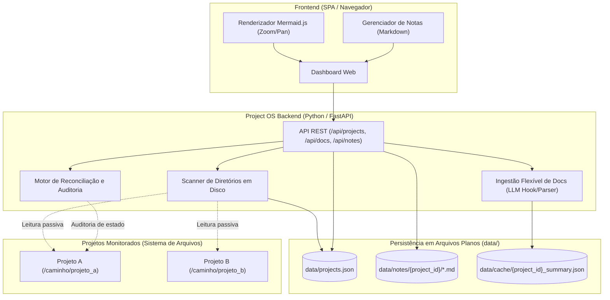
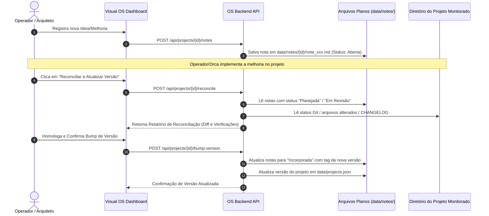

# Design Document: Local Project OS

* **Status:** In Review
* **Author:** Sandro Freitas
* **Date:** 2026-10-30
* **Predecessor Brief:** [concepts_brief.md](file:///C:/Docker/axion-cockpit/concepts_brief.md)

---

## 1. The Problem

Desenvolvedores e arquitetos lidam com múltiplos projetos de software distribuídos localmente em disco. Hoje, a visualização técnica desses projetos sofre de três problemas centrais:

1. **Fragmentação e Falta de Observabilidade Consolidada**: Para inspecionar a arquitetura, o fluxo de dados e os esquemas de banco de dados de cada projeto, o operador precisa navegar manualmente entre diretórios, abrir repositórios isolados e decifrar arquivos dispersos. Não existe uma visão unificada ("cockpit local") para acompanhar a frota de projetos.
2. **Risco de Stale Documentation e Duplicação**: Criar um portal centralizado que replique manualmente especificações ou códigos gera uma segunda fonte da verdade. Essa abordagem rapidamente resulta em drift (dessincronização entre a documentação do portal e o código real).
3. **Falta de Rastreabilidade Pré-Versão para Melhorias**: Ideias, débitos técnicos e notas de revisão costumam poluir commits provisórios ou branches não homologadas nos projetos de destino, ou se perdem em anotações soltas antes de serem formalmente incorporadas e receberem uma nova versão.

Além disso, a estrutura atual deste repositório (`skills-library`) possui scripts e ferramentas acoplados a um modelo de sincronização centralizada de skills multi-LLM (`sync_skills.py`, `catalog.json`), o qual tornou-se obsoleto com a delegação descentralizada de skills para o ambiente global de cada agente e a orquestração via Orca.

---

## 2. Overview

O **Local Project OS** transforma este repositório em um console operacional e visual para gerenciamento e observabilidade arquitetural da frota de projetos locais. 

O sistema opera de forma não-intrusiva como um observador externo:
- Monitora os projetos a partir de seus caminhos absolutos no sistema de arquivos local.
- Utiliza ingestão flexível assistida por LLM para interpretar documentações existentes e extrair resumos visuais de Techspec, Workflows e Diagramas de Banco de Dados renderizados em Mermaid.js no navegador.
- Centraliza um ledger de anotações e melhorias em arquivos planos Markdown por projeto, permitindo maturação de ideias fora do repositório de destino.
- Fornece um mecanismo explícito de reconciliação e auditoria entre o estado do Visual OS e os arquivos reais do diretório do projeto antes de atualizar o número de versão.
- Desvincula e expurga toda a infraestrutura legada de catálogo de skills deste repositório.

---

## 3. Goals & Non-Goals

### 3.1. Goals
* **G1 - Registro Descentralizado de Projetos**: Permitir registrar caminhos de projetos locais em disco e visualizá-los em uma interface web única.
* **G2 - Ingestão Flexível Assistida por LLM**: Extrair resumos estruturados de Techspec, fluxogramas de workflow e esquemas ERD a partir de documentações heterogêneas sem depender de nomes de arquivo rígidos.
* **G3 - Renderização Gráfica Interativa**: Renderizar diagramas de banco de dados e fluxos operacionais client-side em Mermaid.js com controles de zoom e navegação.
* **G4 - Ledger de Melhorias e Ideias Desacoplado**: Manter anotações de melhoria em arquivos planos Markdown categorizados por status (`Ideia`, `Planejado`, `Incorporado`) fora da árvore de commits dos projetos monitorados.
* **G5 - Auditoria de Reconciliação Pré-Versão**: Executar comparação entre os resumos do OS e os registros físicos do projeto antes de homologar a incorporação de melhorias e atualizar a versão.
* **G6 - Persistência Baseada em Arquivos Planos**: Armazenar metadados da frota e notas em arquivos planos (`data/projects.json` e Markdown), eliminando a necessidade de banco de dados no OS.
* **G7 - Limpeza do Legado de Skills**: Expurgar completamente o código legado de sincronização e validação de catálogo de skills.

### 3.2. Non-Goals
* **NG1 - Execução e Orquestração de Agentes**: O OS não executa comandos nem controla runtimes de LLM/agentes; a execução e o comando operacional permanecem externos (via CLI/Orca).
* **NG2 - Edição Direta de Código de Produção**: O OS não funciona como IDE web nem modifica diretamente o código-fonte dos projetos monitorados.
* **NG3 - Parsers Nativos de Drivers de Banco**: O sistema não se conecta a bancos de dados vivos (PostgreSQL, SQLite, MySQL) nem faz engenharia reversa de conexões ativas.
* **NG4 - Banco de Dados Interno no OS**: O OS não utilizará PostgreSQL, SQLite ou MongoDB para armazenar seu estado interno; a persistência é estritamente em arquivos planos.
* **NG5 - Biblioteca Canônica de Skills**: Este repositório não manterá catálogo centralizado nem sincronização de skills.

---

## 4. Technical Plan

### 4.1. Arquitetura de Alto Nível

O sistema é dividido em três camadas desacopladas que operam localmente:



### 4.2. Ingestão Flexível de Documentação

Em vez de depender de caminhos estáticos ou heurísticas frágeis por framework, o OS implementa uma estratégia de descoberta em duas fases:

1. **Varredura Heurística Inicial (Fast Path)**:
   - Procura arquivos candidatos típicos no projeto registrado:
     - Techspec: `TECHSPEC.md`, `docs/TECHSPEC.md`, `README.md`, `pyproject.toml`, `package.json`, `docker-compose.yml`.
     - Workflows: `WORKFLOWS.md`, `docs/WORKFLOWS.md`, diagramas `.mermaid` existentes.
     - Banco de Dados: `DATABASE.md`, `docs/DATABASE.md`, `SCHEMA.md`, `schema.prisma`, `migrations/`.
2. **Normalização e Extração com LLM (Flexible Path)**:
   - Quando os arquivos são dispersos ou não padronizados, o pipeline de ingestão utiliza um contrato de extração assistida por LLM que lê os trechos documentais e gera um JSON consolidado (`_summary.json`) contendo:
     - `techspec`: Stack tecnológica, serviços, dependências principais, portas e variáveis críticas.
     - `workflows`: Código Mermaid renderizável (`flowchart` / `sequenceDiagram`) representando os fluxos operacionais.
     - `database`: Código Mermaid renderizável (`erDiagram`) representando as entidades principais e relacionamentos.
   - O resultado é armazenado em cache local (`data/cache/{project_id}_summary.json`) para renderização instantânea no dashboard sem reprocessamento desnecessário.

### 4.3. Ciclo de Vida de Melhorias e Auditoria de Reconciliação

O fluxo de notas de melhoria é completamente isolado dos commits do projeto monitorado até o momento da incorporação manual.



### 4.4. Especificação de Contratos de API REST

O backend local em FastAPI expõe as seguintes rotas:

| Método | Endpoint | Descrição |
|---|---|---|
| `GET` | `/api/projects` | Lista todos os projetos registrados em `projects.json` com status de acessibilidade e versão |
| `POST` | `/api/projects` | Registra um novo projeto informando nome, caminho em disco (`path`) e tags |
| `DELETE` | `/api/projects/{id}` | Remove um projeto do registro do OS (não deleta a pasta física) |
| `GET` | `/api/projects/{id}/summary` | Retorna o resumo consolidado de Techspec, Workflows e ERD Mermaid (via cache ou parser) |
| `POST` | `/api/projects/{id}/sync` | Dispara re-análise do diretório do projeto e atualiza o resumo |
| `GET` | `/api/projects/{id}/notes` | Retorna a lista de notas de melhoria (`data/notes/{id}/*.md`) |
| `POST` | `/api/projects/{id}/notes` | Cria ou edita uma nota de melhoria (título, descrição Markdown, status, impacto) |
| `DELETE` | `/api/projects/{id}/notes/{note_id}` | Arquiva ou remove uma nota de melhoria |
| `POST` | `/api/projects/{id}/reconcile` | Executa comparação entre notas pendentes e os arquivos do diretório |
| `POST` | `/api/projects/{id}/bump-version` | Marca notas homologadas como `Incorporada` e atualiza versão em `projects.json` |

### 4.5. Estrutura de Arquivos Planos (`data/`)

Nenhum SGBD é requerido. A estrutura em disco segue a convenção:

```
data/
├── projects.json                      # Registro central da frota
├── cache/
│   └── {project_id}_summary.json      # Resumo estruturado extraído (Techspec + Mermaid)
└── notes/
    └── {project_id}/
        ├── note_001.md                # Nota individual com frontmatter (status, data, versão)
        └── note_002.md
```

---

## 5. Alternatives Considered

Durante a concepção técnica, foram analisadas e rejeitadas as seguintes abordagens alternativas:

### 5.1. Parsers Heurísticos Rígidos por Tecnologia (Prisma, Alembic, DDL nativo)
* **Conceito:** Escrever módulos de código em Python para tentar decodificar a sintaxe de cada ORM ou migration de banco de dados nos projetos monitorados.
* **Motivo da Rejeição:**
  - Extremamente frágil a mudanças de versão de bibliotecas nos projetos de destino.
  - Exige manter drivers de banco e parsers para dezenas de ecossistemas (Node, Python, Go, Rust, PHP).
  - Decisão: Adotar convenção simples de documentação assistida por LLM com renderização padrão em diagramas Mermaid.

### 5.2. Banco de Dados Embutido Interno (SQLite ou NoSQL embutido)
* **Conceito:** Utilizar um arquivo `.db` gerenciado por SQLite ou TinyDB para registrar projetos e notas de melhoria.
* **Motivo da Rejeição:**
  - Bloqueia visualização e edição direta pelo desenvolvedor fora da UI web.
  - Complica o versionamento Git (arquivos binários `.db` geram conflitos frequentes de merge).
  - Adiciona dependência de camada ORM/migração interna sem ganho prático para volumes locais (dezenas de projetos).
  - Decisão: Persistência estrita em arquivos planos JSON e Markdown (`data/projects.json` e `data/notes/`).

### 5.3. Atualização Direta de Versão sem Auditoria de Reconciliação
* **Conceito:** Permitir que o operador simplesmente clique em "Incrementar Versão" no dashboard, sem comparar com os arquivos físicos.
* **Motivo da Rejeição:**
  - Gera alto risco de drift silencioso: a documentação no OS registra que uma funcionalidade existe na `v1.2.0`, mas o código no diretório físico ainda não foi comitado ou mergeado.
  - Decisão: Criação de etapa de auditoria pré-versão (`/api/projects/{id}/reconcile`), comparando o ledger de melhorias com o estado físico de arquivos e changelogs antes de consolidar a versão.

### 5.4. Coexistência de Skills e Project OS no Mesmo Repositório
* **Conceito:** Manter os scripts de compilação de skills (`sync_skills.py`, `catalog.json`) dividindo espaço com as rotas do Project OS.
* **Motivo da Rejeição:**
  - Sobrecarga cognitiva e duplicidade de responsabilidades. O ecossistema de skills agora é mantido em nível de sistema de cada agente/LLM, enquanto a orquestração operacional é conduzida pelo Orca.
  - Decisão: Corte limpo (*clean cut*) e expurgo de todo o código legado de catálogo de skills.

---

## 6. Detailed Implementation Plan

O plano de implementação é estruturado em etapas sequenciais e auto-contidas, enumerando cada arquivo impactado:

### 6.1. Fase 1: Expurgo do Legado de Skills
Remoção completa dos componentes e automações da antiga biblioteca de skills.

* **Arquivos a Excluir**:
  - `scripts/sync_skills.py`: Excluir script obsoleto de sincronização e parsing de frontmatters de skills.
  - `catalog.json`: Excluir catálogo JSON canônico de skills.
  - `templates/SKILL_TEMPLATE.md`: Excluir template de criação de skills.
  - Diretório `global/`: Excluir todas as pastas e arquivos de skills globais (`global/interface-design/`, `global/code-review/`, etc.), delegadas para os ambientes globais das LLMs.
  - `.github/workflows/validate.yml`: Excluir workflow de validação do catálogo de skills no CI.
  - `ui/fleet.json`: Excluir arquivo legado restrito, substituído pela base `data/projects.json`.

### 6.2. Fase 2: Estrutura de Dados e Templates de Convenção
Criação dos diretórios locais de persistência em arquivos planos e templates de referência para documentação dos projetos.

* **Arquivos a Criar**:
  - `data/projects.json`: Inicializar com schema vazio (`[]`), servindo de registro central da frota de projetos.
  - `data/notes/.gitkeep`: Garantir existência da pasta base onde cada projeto terá seu subdiretório de notas Markdown.
  - `data/cache/.gitkeep`: Garantir existência da pasta onde os resumos estruturados dos projetos (`{project_id}_summary.json`) serão mantidos.
  - `templates/convention/TECHSPEC.template.md`: Template padrão com seções de Stack, Serviços, Variáveis de Ambiente e Arquitetura.
  - `templates/convention/WORKFLOWS.template.md`: Template com exemplos de blocos Mermaid `flowchart` e `sequenceDiagram`.
  - `templates/convention/DATABASE.template.md`: Template com exemplo de bloco Mermaid `erDiagram` para entidades e chaves relacionais.

### 6.3. Fase 3: Motores de Backend (Scanner, Reconciler e LLM Bridge)
Construção dos módulos Python responsáveis pela leitura passiva em disco, reconciliação de estado e extração estruturada.

* **Arquivos a Criar**:
  - `app/engine/scanner.py`:
    - *Responsabilidade*: Módulo de varredura não-intrusivo. Dado o caminho absoluto de um projeto, busca arquivos de documentação (`TECHSPEC.md`, `WORKFLOWS.md`, `DATABASE.md`, `README.md`, etc.), verifica se o caminho existe, detecta alterações na data de modificação e gera o pacote de dados bruto para extração.
  - `app/engine/reconciler.py`:
    - *Responsabilidade*: Módulo de comparação e auditoria pré-versão. Compara a lista de notas com status `planejado` ou `em-revisao` com os arquivos físicos alterados no repositório monitorado (via status Git local ou datas de alteração), emitindo relatório de verificação para homologação do operador.
  - `app/engine/llm_bridge.py`:
    - *Responsabilidade*: Normalizador flexível. Processa o conteúdo textual bruto capturado pelo `scanner.py` e extrai as seções de Techspec, os blocos de fluxo Mermaid e os diagramas ERD, gravando o cache consolidado em `data/cache/{project_id}_summary.json`.

### 6.4. Fase 4: Refatoração da API REST do Servidor
Atualização completa do servidor local em Python para suportar as novas rotas do Project OS.

* **Arquivos a Modificar**:
  - `ui/app.py`:
    - *Alterações*:
      - Remover todos os imports, referências e rotas ligadas a `sync_skills` e `catalog.json`.
      - Remover a restrição `is_internal_project`, permitindo que o operador aponte para qualquer diretório local válido do sistema de arquivos (`C:/Docker/...`, etc.).
      - Integrar `scanner.py`, `reconciler.py` e `llm_bridge.py`.
      - Implementar endpoints REST: `/api/projects` (CRUD de frota), `/api/projects/{id}/summary` (leitura de documentação consolidada), `/api/projects/{id}/notes` (gestão de notas Markdown), `/api/projects/{id}/reconcile` (auditoria pré-versão) e `/api/projects/{id}/bump-version` (homologação de versão).

### 6.5. Fase 5: Dashboard Visual (Frontend e Mermaid.js)
Evolução da interface web existente para atuar como o cockpit do Project OS.

* **Arquivos a Modificar**:
  - `ui/index.html`:
    - *Alterações*:
      - Novo cabeçalho e branding: "Project OS — Operations & Architecture Cockpit".
      - Sidebar reformulada com seletor de projetos monitorados, status de saúde da documentação e atalho para registrar novo diretório.
      - Área de visualização dividida em abas:
        1. **Visão Geral & Techspec**: Cards com resumo de stack, dependências e serviços.
        2. **Workflows**: Canvas com renderizador Mermaid.js interativo (suporte a zoom e arrastar).
        3. **Banco de Dados**: Canvas Mermaid.js dedicado para o diagrama ERD.
        4. **Ledger de Melhorias**: Interface Kanban/lista para criar e visualizar notas de melhoria (`Ideia` -> `Planejado` -> `Em Revisão` -> `Incorporado`).
      - Modal de Reconciliação: Interface para revisar discrepâncias entre as notas do OS e os arquivos reais do projeto antes de autorizar o incremento de versão.

### 6.6. Fase 6: Documentação e Governança do Repositório
Atualização dos artefatos institucionais do repositório para refletir o novo propósito.

* **Arquivos a Modificar**:
  - `README.md`:
    - *Alterações*: Substituir o conteúdo focado em `skills-library` por um guia completo do Project OS:
      - Arquitetura e propósito do sistema.
      - Instruções de inicialização do backend (`python ui/app.py`).
      - Como registrar novos projetos e estrutura da convenção de documentação recomendada.
      - Fluxo de trabalho com o Orca e ciclo de reconciliação de notas/versões.
  - `.gitignore`:
    - *Alterações*: Garantir exclusão de `data/cache/*.json` e caches Python (`__pycache__`), mantendo preservados `data/projects.json` e `data/notes/`.
