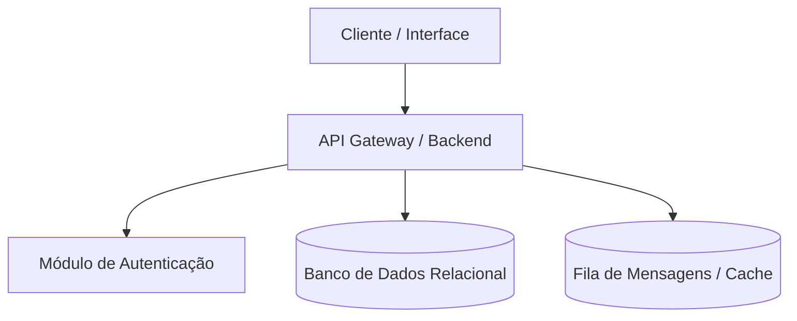
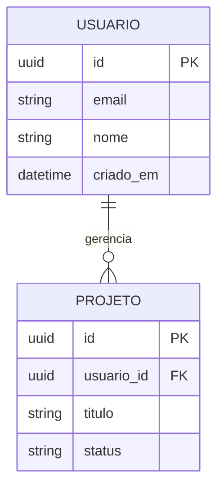

# [Nome do Projeto] — Arquitetura e Especificação Técnica

* **Versão:** v1.0.0
* **Data:** AAAA-MM-DD
* **Status:** Ativo

---

## 1. Visão Geral

Descreva em 2 a 3 parágrafos o propósito central deste projeto, os problemas que ele resolve e os usuários ou sistemas consumidores.

---

## 2. Techspec (Especificação Técnica)

* **Linguagem / Runtime:** Ex: Python 3.12 / Node.js 22 / Go 1.23
* **Framework Principal:** Ex: FastAPI / Express / Next.js
* **Armazenamento / Banco de Dados:** Ex: PostgreSQL 16, Redis
* **Portas Padrão:** `8000` (API), `5432` (PostgreSQL)
* **Variáveis de Ambiente Críticas:**
  - `DATABASE_URL`: String de conexão com o banco
  - `ENV`: `development` | `staging` | `production`

---

## 3. Workflows Operacionais

Descreva o fluxo principal de dados ou execução do sistema utilizando diagramas Mermaid.

---

## 4. Banco de Dados e Esquema de Dados

Defina as entidades centrais e seus relacionamentos utilizando diagrama ERD Mermaid.

